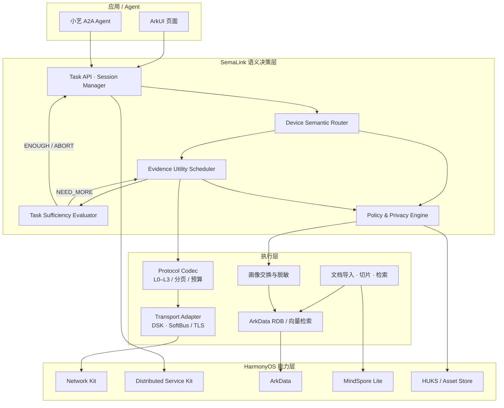

# SemaLink

> 面向 HarmonyOS 的多设备语义自适应端侧通信中间件：让设备只交换任务所需的证据，而不是整个文件。

**English summary** — SemaLink is an on-device communication middleware for HarmonyOS multi-device scenarios. Instead of syncing whole files to one device, it routes each task to the device most likely to hold the answer, transfers evidence progressively (L1 summary → L2 snippet → L3 raw file), and stops as soon as the task's evidence budget is satisfied.

---

## 为什么做这个

多设备协同最常见的做法是"先把文件同步过去，再在本地检索"：

- 传输量大，首结果慢，大部分字节和当前任务无关；
- 原始文件离开本机，隐私成本高；
- 设备之间没有"该问谁"的判断，只能广播或人工选择。

SemaLink 把跨设备查询抽象成 **任务 + 预算 + 证据**：先判断哪台设备最可能有答案，再按"单位代价收益"逐级获取证据，证据足够就立即停止。数据尽量留在原设备，跨设备流动的只有任务描述、候选证据和必要片段。

## 核心机制

### 1. 设备语义路由

每台设备维护自己的知识画像（知识域、文档数量、画像版本与 digest）。查询到来时按任务语义与设备画像匹配度排序候选设备，默认只问 Top-1；仅当目标设备返回 `BUSY` 或网络失败时才回退 Top-2，其他拒绝不会触发广播。

### 2. 分级证据传输（L0–L3）

| 级别 | 内容 | 说明 |
| --- | --- | --- |
| L0 | 能力/画像摘要 | 只交换 `profileVersion + profileDigest`，内容不离开设备 |
| L1 | 标题 + 摘要片段 | 默认工作级，用于快速判断"有没有" |
| L2 | 命中段落、表格、OCR 片段 | 需要设备单独授权 |
| L3 | 原始文件 | 默认关闭，需显式策略与用户确认 |

### 3. 证据边际效用调度

候选证据按"单位字节/时延带来的相关性增益"排序，结合带宽、延迟、电量和任务预算决定先传哪条、传到哪一级。单条逻辑响应默认不超过 64 KiB；超预算时先丢弃低相关证据，再截断摘要并标记 `truncated`。

### 4. 任务充分性反馈（TSF）

接收端根据证据覆盖度返回 `NEED_MORE`、`ENOUGH` 或 `ABORT`，发送端据此继续、早停或终止。停止条件不是"文件传完了"，而是"任务已经被满足"。

### 5. 隐私与信任

- 设备信任状态：`PENDING` / `TRUSTED` / `BLOCKED` / `REVOKED`，系统可见不等于应用已信任；
- 画像 digest-first 交换，画像域上限 20、序列化上限 8 KiB；
- 远程证据脱敏：移除绝对路径、SQL、数据库/文档/Chunk ID、硬件标识与原始异常；
- 访问记录不保存完整问题或证据正文；
- 分享策略按设备和证据级别独立控制。

### 6. 可靠性

- 幂等：同一 `requestId` 在 5 分钟内复用结果，缓存上限 128；
- 并发：单设备同时执行上限 2、队列上限 4，超限返回 `BUSY`；
- 超时：检索 deadline 5 秒，迟到结果不进入 UI；
- 取消：取消信号贯穿授权、排队与执行阶段，终态只提交一次；
- 断线：任务以明确错误码结束，不重复下发。

## 架构



## 项目状态

这是一个面向多设备知识检索的**竞赛 / 研究原型**，已完成主链路实现，并保留了明确的验收边界：

| 能力 | 状态 |
| --- | --- |
| HAP 构建（HarmonyOS 6.1.1 / API 24，ArkTS） | 通过 |
| 双真机 DSK / SoftBus 通道 | 已验证：`DATA_BIND_ACK`、`DATA_PING/PONG`、跨设备 `QUERY/ACK/RESULT` 双向到达 |
| 三设备确定性假环境与故障矩阵 | 完成：互补证据、重复去重、冲突隔离、断线、取消、迟到帧、连续十次任务资源回收 |
| 三真机端到端验收 | **未执行**（缺少第三台在线设备），验收步骤见 [`docs/testing/cross-device-knowledge-three-device-test.md`](docs/testing/cross-device-knowledge-three-device-test.md) |
| 小艺 A2A V0.6 Agent 入口 | 已实现 `message/stream`、`tasks/cancel`、`INPUT_REQUIRED` 恢复；真机测试待执行 |
| 性能指标 | 仅定义了竞品验收目标，**尚无真机实测数据** |

> 性能目标（非实测结果，见 [`docs/SemaLink_核心性能指标.md`](docs/SemaLink_核心性能指标.md)）：设备路由 Top-1 ≥ 85%、首结果 P95 ≤ 1.5 s、单任务通信量 ≤ 64 KiB、L1/L2 即可完成比例 ≥ 90%。

## 技术栈

| 分类 | 技术 |
| --- | --- |
| 语言 / UI | ArkTS · ArkUI · HarmonyOS 6.1.1（API 24） |
| 跨设备 | Distributed Service Kit（DSK / SoftBus）、Network Kit（TCP / TLS / Multicast） |
| 数据 | ArkData RDB + 向量检索、关系型元数据与任务状态 |
| 端侧 AI | MindSpore Lite（嵌入 / 推理）、HUKS / Asset Store |
| Agent | 小艺 A2A V0.6（`message/stream`、`tasks/cancel`、Context/Task 生命周期） |
| 测试 | Hypium 单元测试、ohosTest 真机测试、三设备假网络与故障注入 |

## 目录结构

```text
entry/src/main/ets/
├── agent/           小艺 A2A 协议、Agent 执行器与任务状态机
├── communication/   设备目录、DSK/SoftBus、TLS、路由、预算、证据聚合
├── crossdevice/     跨设备查询服务、画像交换、脱敏、协作仓储
├── knowledge/       文档导入、切片、检索、L1/L2 载荷与知识画像
├── protocol/        多设备协议编解码、分页与预算控制
├── application/     查询协调与应用服务
├── runtime/         运行时装配与状态管理
└── pages/           ArkUI 页面与协作记录 UI
entry/src/test/      Hypium 单元测试（含三设备假环境、隐私、并发、幂等）
entry/src/ohosTest/  真机测试
docs/                架构方案、性能目标、设计文档与验收记录
scripts/             部署脚本与本地检索 benchmark
```

## 快速开始

**环境**

- DevEco Studio（HarmonyOS 6.1.1 / API 24 SDK）
- 两台及以上 HarmonyOS API 24 设备；跨设备协同要求同一华为账号、同一 `bundleName`、已完成可信组网
- 权限：`INTERNET`、`GET_NETWORK_INFO`、`SET_NETWORK_INFO`、`DISTRIBUTED_DATASYNC`

**运行**

1. 用 DevEco Studio 打开项目；
2. 在 DevEco Studio 中配置你自己的签名（File → Project Structure → Signing Configs）；
3. 连接真机，执行 `Run` 安装到所有参与协同的设备。

**命令行构建 / 测试**

```powershell
# 使用 DevEco Studio 自带的 hvigor（路径以本机安装为准）
hvigorw --mode module -p module=entry@default -p product=default -p requiredDeviceType=phone assembleHap
hvigorw --mode module -p product=default -p module=entry@default -p buildMode=debug test
```

本地检索 benchmark：

```powershell
.\scripts\run-local-retrieval-benchmark.ps1 -SdkHome $env:DEVECO_SDK_HOME
```

## 文档

- [总体架构方案](docs/SemaLink_ArkData_总体架构方案.md)
- [核心性能指标与验收口径](docs/SemaLink_核心性能指标.md)
- [跨设备通信可行性验证](docs/SemaLink_甲_跨设备通信可行性验证架构文档.md)
- [三设备跨设备知识闭环测试](docs/testing/cross-device-knowledge-three-device-test.md)
- [小艺 A2A V0.6 真机交接](docs/testing/xiaoyi-agent-a2a-v06-handoff.md)
- [API 24 原生接口契约](docs/testing/api24-native-contract.md)

## 说明

- 本项目为学习、竞赛与研究用途的原型，尚未达到生产可用标准；
- 仓库中的性能数值分为「验收目标」与「实测结果」，未标注实测的数据不应视为已达成；
- 日志与验收记录只保留脱敏后的设备别名、稳定错误码和有限数值，不记录设备标识、文件路径、SQL 或文档正文。

## License

暂未添加开源许可证，默认保留所有权利。如需引用、复用或二次开发，请先联系作者。
