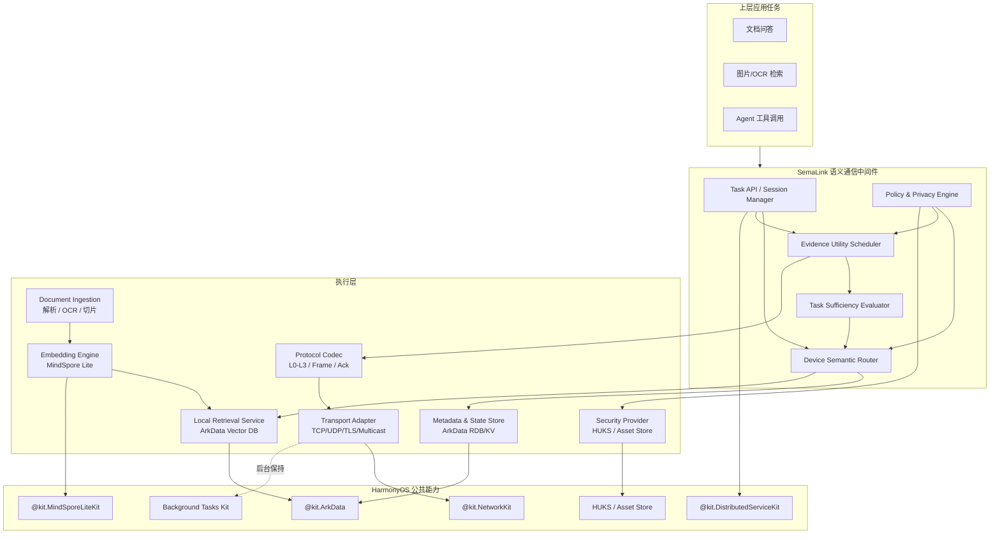
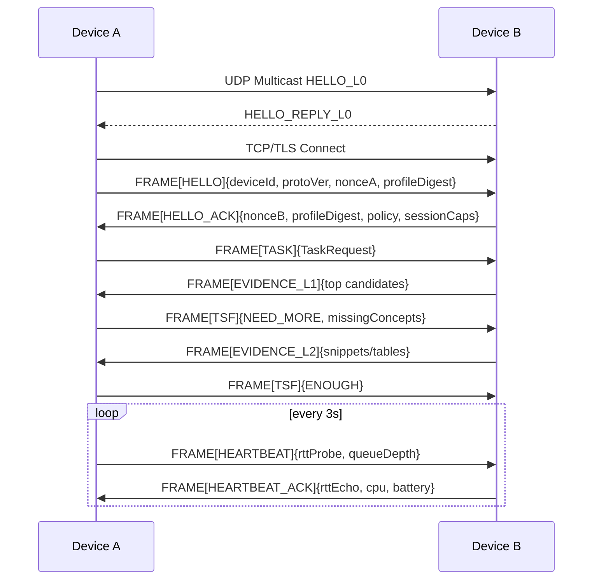

# 纯血 HarmonyOS 多设备智能任务语义自适应端侧通信中间件架构方案

**执行摘要**
- 本报告给出一个可在**普通 HarmonyOS HAP**内部实现的中间件方案：底层依托 **Network Kit / Distributed Service Kit / ArkData / MindSpore Lite / HUKS**，上层自定义“任务—证据—反馈”闭环，不依赖未公开系统接口。
- 方案的核心不是“让设备连起来”，而是让多设备在**任务驱动、渐进传输、隐私优先**的约束下，自动决定**询问哪台设备、先传什么、何时停止传输**。这一定位与现有分布式 RAG、任务导向语义通信和鸿蒙分布式能力形成互补。
- 技术上采用“两层通信实现”：**传输层**优先使用 Network Kit 的 TCP/UDP/Multicast/TLS；**设备协同增强层**按需接入 Distributed Service Kit，用于可信设备发现、跨设备拉起和会话绑定。HarmonyOS 官方文档已明确提供这些公共能力。
- 本地文档检索统一采用 **ArkData 向量数据库 + 关系型数据库**：向量数据库负责语义召回，RDB/KV 负责文档元数据、设备画像、索引版本和任务状态。HarmonyOS 官方文档显示，向量数据库从 API 18 起支持，并支持 `floatvector` 等向量字段。
- 最终项目收敛为：**面向无中心可信设备组网的任务感知证据渐进式通信中间件**。其核心创新锁定在三处：**设备语义路由、证据边际效用调度、Task Sufficiency Feedback**。


## 方案目标与设计原则

本方案的总体目标是：在**纯血 HarmonyOS**上实现一个**普通 HAP 可部署**、面向多设备智能任务的语义自适应端侧通信中间件，使数据尽可能留在原设备，仅让“任务描述、候选证据和必要原文片段”跨设备流动。HarmonyOS 的公开能力已经能提供 Socket/TLS 传输、跨设备应用协同、ArkData 数据存储与同步、端侧向量检索以及 MindSpore Lite 推理，因此这一目标不要求修改闭源系统内核或直接调用未公开 DSoftBus 内部接口。

为了覆盖你要求的“普通 HAP 可部署”，本文建议把**最低统一目标版本**设为 **API 18+**。原因很直接：跨设备连接 UIAbility 的官方能力从 API 18 起支持，设备间需要登录同一华为账号且对端安装相同 `bundleName` 的应用；同时，HarmonyOS 官方文档表明 ArkData 的向量数据库从 API 18 开始支持。这样可以让“跨设备协同入口”和“本地向量持久化”都落在同一版本基线内。

设计原则建议固定为四条。

第一，**任务驱动**。所有跨设备请求都先被抽象为任务，而不是“发文件”“同步目录”。任务必须显式携带语义目标、时延预算、字节预算、精度阈值和隐私等级。这样才能把“找哪台设备、传哪部分数据、何时停止”统一到一个调度面上。相关研究表明，分布式 RAG 与任务导向语义通信都在从“原始数据中心化传输”转向“任务相关信息优先传输”。

第二，**渐进传输**。传输不再以“完整文件传完”为结束条件，而是以“任务是否已被满足”为结束条件。现有语义通信研究已经反复证明，分阶段、可细化的表示能够在带宽受限场景下更好地权衡延迟、任务效果和通信量；CONCORD 则在 RAG 场景里把远端证据视作“异步到达的补充证据源”，而不是持续同步的共生成器。

第三，**隐私优先**。每台设备保有本地知识和索引，对外默认只暴露能力画像、知识域摘要、哈希/版本、低风险摘要和必要证据片段；任何高隐私原始数据都必须由策略和用户确认控制。DGRAG、DRAG 和分布式 RAG/DRAG 一类工作之所以成立，正是因为“分布式数据不集中上收”可以缓解隐私泄漏和大规模中心化检索开销。

第四，**普通 HAP 可部署**。本方案优先使用官方开放能力：`@kit.NetworkKit` 的 Socket/TLS、`@kit.DistributedServiceKit` 的跨设备协同、`@kit.ArkData` 的向量数据库/RDB/KV、`@kit.MindSporeLiteKit` 的端侧推理，以及 HUKS/Asset Store 的密钥与凭据保护。官方文档分别明确了这些能力的存在与接入方式。

## 模块化架构与数据模型

下面给出中间件总览。它分成**应用层、语义决策层、执行层、HarmonyOS 能力层**四层。上层任务统一通过中间件 API 进入；语义决策层负责路由、证据排序和反馈闭环；执行层负责文档导入、向量化、本地检索和协议编解码；底层统一映射到 HarmonyOS 官方公开能力。ArkData 在本方案中是唯一的本地结构化与向量检索底座：向量数据库负责候选召回，RDB/KV 负责元数据、版本和状态。



为了方便直接开发，建议把模块边界定得非常清楚：

| 模块 | 核心职责 | 典型输入 | 典型输出 |
|---|---|---|---|
| Task API | 接收上层任务、分配 taskId、管理会话生命周期 | `TaskRequest` | `TaskHandle` |
| Device Semantic Router | 基于设备能力画像和任务语义选择目标设备 | `TaskRequest`、设备目录 | 设备候选列表 |
| Evidence Utility Scheduler | 对候选证据按“单位代价收益”排序并决定传输级别 | `EvidenceUnit[]`、带宽/延迟/电量 | 发送计划 |
| Task Sufficiency Evaluator | 根据当前证据覆盖度判断是否足够回答任务 | 已接收证据、用户反馈 | `TaskSufficiencyFeedback` |
| Document Ingestion | 负责文件授权、解析、OCR、切片与增量更新 | 文件 URI、文档元数据 | `DocumentChunk[]` |
| Local Retrieval Service | 调用 ArkData 完成向量召回、条件过滤、关键词补充和结果重排 | 查询向量、过滤器 | 候选证据 |
| Protocol Codec | 帧化、压缩、重传、ACK/TSF 编解码 | 任务/证据对象 | 协议帧 |
| Metadata & State Store | 保存文档元数据、设备画像、索引版本、任务状态与反馈记录 | 状态更新 | ArkData 持久化对象 |

### 任务描述与证据对象

建议把所有跨设备任务统一成如下 JSON 数据模型。字段设计里最关键的是：**显式预算** 与 **显式反馈目标**。

```json
{
  "taskId": "tsk-20260712-0001",
  "taskType": "knowledge_query",
  "queryText": "找到比赛文档中提到 Recall@10 和内存占用的数据",
  "queryEmbedding": {
    "dim": 384,
    "dtype": "float32",
    "codec": "f16pack",
    "dataBase64": "AAAB..."
  },
  "requiredConfidence": 0.90,
  "latencyBudgetMs": 800,
  "byteBudget": 65536,
  "privacyLevel": "PRIVATE_GROUP",
  "acceptableLevels": ["L1", "L2"],
  "filters": {
    "modalities": ["text", "pdf", "ocr_text"],
    "timeRange": ["2026-01-01", "2026-07-12"],
    "tags": ["benchmark", "memory", "recall"]
  },
  "hints": {
    "preferredDevices": ["tablet-lab", "pc-office"],
    "forbidRawData": true
  }
}
```

设备端本地搜索返回的每一项，都不要直接等同于“文件”；更好的做法是把它定义为**证据单元**：

```json
{
  "evidenceId": "ev-0018",
  "sourceDeviceId": "tablet-lab",
  "sourceDocId": "doc-2026-report-17",
  "modality": "text",
  "level": "L2",
  "title": "2026 项目测试报告",
  "snippet": "Recall@10=0.932，peak memory=18.7MB，dataset=internal_eval_v3",
  "offset": {
    "page": 7,
    "startChar": 128,
    "endChar": 266
  },
  "hash": "sha256:3ff0a4...",
  "relevance": 0.94,
  "estimatedCoverageGain": 0.21,
  "byteCost": 2480,
  "privacyCost": 0.15,
  "energyCost": 0.04,
  "canEscalateTo": ["L3"],
  "dependencies": ["doc-2026-report-17#table-2"]
}
```

接收端反馈不建议只用传统 ACK，而要显式编码成**Task Sufficiency Feedback**：

```json
{
  "taskId": "tsk-20260712-0001",
  "status": "NEED_MORE",
  "answerCoverage": 0.74,
  "confidence": 0.81,
  "evidenceDiversity": 0.58,
  "missingConcepts": ["测试设备型号", "实验条件"],
  "requestedEvidenceTypes": ["benchmark_table", "metadata"],
  "preferredNextLevels": ["L2"],
  "maxAdditionalBytes": 32768,
  "acceptedEvidenceIds": ["ev-0018", "ev-0025"],
  "rejectedEvidenceIds": ["ev-0019"]
}
```

### 关键接口建议

下列接口是面向工程实现的 ArkTS 抽象，不是官方 SDK 原始签名。底层实现通过 `@kit.ArkData`、`@kit.MindSporeLiteKit` 和 `@kit.NetworkKit` 完成。

```ts
export type PayloadLevel = 'L0' | 'L1' | 'L2' | 'L3';

export interface TaskRequest {
  taskId?: string;
  taskType: 'knowledge_query' | 'ocr_search' | 'agent_tool';
  queryText?: string;
  queryEmbedding?: Float32Array;
  requiredConfidence: number;
  latencyBudgetMs: number;
  byteBudget: number;
  privacyLevel: 'LOCAL_ONLY' | 'PRIVATE_GROUP' | 'RAW_ALLOWED';
  acceptableLevels: PayloadLevel[];
  filters?: Record<string, Object>;
}

export interface IndexedDocument {
  documentId: string;
  title: string;
  uri: string;
  modality: 'text' | 'pdf' | 'image' | 'ocr_text';
  tags: string[];
  privacyLevel: 'LOCAL_ONLY' | 'PRIVATE_GROUP' | 'RAW_ALLOWED';
  updatedAt: number;
}

export interface DocumentChunk {
  chunkId: string;
  documentId: string;
  text: string;
  page?: number;
  startOffset?: number;
  endOffset?: number;
  embedding: Float32Array;
  metadata: Record<string, Object>;
}

export interface EvidenceUnit {
  evidenceId: string;
  sourceDeviceId: string;
  sourceDocId: string;
  level: PayloadLevel;
  relevance: number;
  estimatedCoverageGain: number;
  byteCost: number;
  privacyCost: number;
  hash: string;
  payload: ArrayBuffer | string;
}

export interface TaskSufficiencyFeedback {
  taskId: string;
  status: 'ENOUGH' | 'NEED_MORE' | 'NEED_ORIGINAL' | 'ABORT';
  answerCoverage: number;
  confidence: number;
  missingConcepts: string[];
  maxAdditionalBytes: number;
}

export interface LocalRetrievalService {
  indexDocument(document: IndexedDocument): Promise<void>;
  updateDocument(document: IndexedDocument): Promise<void>;
  deleteDocument(documentId: string): Promise<void>;
  search(task: TaskRequest, topK: number): Promise<EvidenceUnit[]>;
}

export interface SemaLinkApi {
  submitTask(task: TaskRequest): Promise<string>;
  cancelTask(taskId: string): Promise<void>;
  observeTask(taskId: string, cb: (event: Object) => void): () => void;
  registerLocalCorpus(corpusId: string, uriList: string[]): Promise<void>;
  updateDeviceProfile(profilePatch: Object): Promise<void>;
}
```

`LocalRetrievalService.search()` 的职责边界固定为：生成/接收查询向量，调用 ArkData 做 Top-K 向量召回，叠加时间、模态、标签和隐私条件过滤，必要时进行轻量重排，最后转换为统一的 `EvidenceUnit`。设备路由和跨设备传输不进入数据库层。

## 传输协议与安全设计

HarmonyOS 的 Socket 连接官方文档明确写出：Socket 数据传输支持 **TCP / UDP / Multicast / TLS**；这使得“Multicast 发现 + TCP/TLS 可靠传输”成为非常自然的普通 HAP 方案。对于需要鸿蒙特色演示的版本，再叠加 Distributed Service Kit 的跨设备协同即可。

### 载荷分级

建议把传输目标拆成 **L0–L3** 四级：

| 级别 | 内容 | 典型大小 | 用途 |
|---|---:|---:|---|
| L0 | 设备能力画像、索引摘要、版本、策略、任务路由信息 | 0.5–4 KB | 发现、路由、会话预热 |
| L1 | 文件名/标题、标签、相关度、短摘要、局部哈希 | 1–8 KB | 快速筛选与首结果展示 |
| L2 | 命中段落、OCR 文本块、缩略图、表格片段、压缩向量 | 2–64 KB | 大多数问答任务的主工作级 |
| L3 | 原图、整页 PDF、完整文档、原始二进制 | 64 KB–MB 级 | 只在用户确认或模型要求时发送 |

这里的关键不是“把文件分片”，而是**把信息价值分级**。L1 和 L2 的默认目标是尽量在不发送原始文件的前提下满足任务。

### 帧格式

建议定义一个极小化、可 binary-serialize 的应用层帧：

```text
FrameHeader
- magic            2B   // 0x53 0x4C = 'SL'
- version          1B
- msgType          1B   // HELLO / PROFILE / TASK / EVIDENCE / TSF / HEARTBEAT / ERROR
- flags            2B   // encrypted, compressed, fragment, final, ack-required...
- sessionId        8B
- taskIdHash       8B
- seqNo            4B
- ackNo            4B
- payloadLevel     1B   // 0~3
- payloadCodec     1B   // json, cbor, flatbuf, raw
- payloadLength    4B
- headerCrc32      4B

Payload
- bytes[payloadLength]

Trailer
- payloadCrc32     4B
```

若初期以开发速度为先，`Payload` 可以先用 JSON/CBOR；后续再切 FlatBuffers 或自定义二进制。建议先以结构化 JSON 打通端到端链路，因为真正需要优化的是证据载荷、检索次数与传输轮次，而不是头部解析。

### 握手、心跳与状态机

因为普通 HAP 可直接使用 TCP/TLS Socket，所以推荐**会话握手**与**应用层鉴权**分离：
一层是 TLS 或 TCP 连接；另一层是 SemaLink 自己的 `HELLO/PROFILE/ACCEPT` 语义握手。



心跳建议每 3 秒发一次，内容至少包括：

- 最近 RTT；
- 待发送队列深度；
- 对端 CPU/内存/电量粗粒度状态；
- 会话字节计数；
- 最近一次 TSF 结果。

这样调度器就能把**网络状态**和**设备状态**纳入统一决策。DRAGON 之所以有效，核心就在于把实时网络条件引入调度侧。

### 加密与鉴权

HarmonyOS 公开资料表明，Socket 支持 TLS，且支持构造**双向认证**的 TLS Socket；同时 HUKS 提供密钥生成、签名验签、密钥协商等能力。对于普通 HAP，这足够做成“Transport 层加密 + App 层设备身份绑定”的安全架构。

建议给出两种安全模式：

**模式 A：开发/演示优先**
- Transport：TLS 单向认证或双向认证。
- 应用层：对 `HELLO` 和 `PROFILE` 做 HMAC。
- 密钥存储：Asset Store / HUKS 保存应用本地密钥。

**模式 B：研究/竞赛完整形态**
- 设备首次安装时生成 HUKS 管理的 X25519/ECC 密钥对；
- 握手阶段交换公钥摘要、签名和随机数；
- 用 ECDH 派生会话密钥，再用 HKDF 派生 `encKey/macKey`；
- 载荷使用 AES-GCM；
- 重要控制帧额外做签名或 HMAC；
- 敏感本地目录/索引元数据使用加密数据库或 E 类加密数据库。HarmonyOS 官方已给出 E 类加密数据库方案。

### 错误处理与重传策略

错误与重传建议设计成**两层**：

一层是**字节可靠性**：
- `ACK_TIMEOUT`
- `SEQ_GAP`
- `CRC_FAIL`
- `FRAGMENT_MISSING`
- `SESSION_EXPIRED`

另一层是**语义充分性**：
- `TASK_UNDER_SPECIFIED`
- `INSUFFICIENT_EVIDENCE`
- `POLICY_DENIED`
- `BYTE_BUDGET_EXCEEDED`
- `PRIVACY_ESCALATION_REQUIRED`

重传遵循下面规则：

1. L0/L1 控制帧必须可靠送达，采用 ACK + 超时重发。
2. L2 支持 selective retransmission，仅重发丢失片段。
3. L3 不启用盲目自动重发，必须结合 TSF 判断，否则可能把大文件无意义重传。
4. 若应用退后台且未申请长时任务，默认立即优雅断链；官方文档说明，无长时任务的应用退后台时应主动断开 TCP/UDP，若不主动断开，系统会强制断开 TCP。

## 设备语义路由与证据调度算法

设备语义路由的目标不是简单决定“谁在线”，而是估计**哪台设备最可能给出高价值证据，且总代价最低**。这一思路与分布式 RAG 中的“知识摘要路由”相近：DGRAG 让边缘设备只共享知识摘要而非原始知识库，DRAG/DRAGON 则把隐私文档保留在本地。

### 设备能力画像

建议在每台设备维护一个轻量 `DeviceProfile`，同步到本地元数据目录。`DeviceProfile` 通过 ArkData KV/RDB 同步到可信设备组网只是可选能力；更稳妥的默认方式还是通过 L0 广播与本地缓存维护。ArkData 已明确面向可信认证的不同设备间的应用数据同步。

```json
{
  "deviceId": "tablet-lab",
  "deviceClass": "tablet",
  "apiVersion": 18,
  "bundleName": "com.example.semalink",
  "modalities": ["text", "pdf", "image", "ocr_text"],
  "capabilities": ["vector_search", "keyword_search", "ocr_index", "thumb_render"],
  "knowledgeDomains": [
    {"tag": "竞赛资料", "weight": 0.93},
    {"tag": "系统性能测试", "weight": 0.88},
    {"tag": "HarmonyOS", "weight": 0.81}
  ],
  "indexStats": {
    "docCount": 531,
    "vectorDim": 384,
    "updatedAt": "2026-07-11T22:13:00+09:00"
  },
  "privacyPolicy": {
    "allowRawData": false,
    "allowSummary": true,
    "allowSnippet": true
  },
  "runtime": {
    "battery": 0.72,
    "cpuLoad": 0.34,
    "networkType": "wifi",
    "lastRttMs": 23
  }
}
```

### 路由评分函数

定义任务查询向量为 $q$，设备画像语义中心为 $p_d$，过滤条件满足度为 $f_d\in[0,1]$，运行时代价项为网络、能耗与隐私等组合。推荐的第一版评分函数：

$$
S(d \mid q)=
\alpha \cdot \cos(q,p_d)
+\beta \cdot f_d
+\gamma \cdot Freshness_d
-\delta \cdot RTT_d
-\epsilon \cdot Load_d
-\zeta \cdot PrivacyRisk_d
$$

其中：

- $\cos(q,p_d)$：任务与设备知识域的语义相似度；
- $f_d$：模态、时间、标签、数据类别等硬过滤条件满足度；
- `Freshness_d`：索引最近更新时间；
- `RTT_d`：最近心跳测得延迟；
- `Load_d`：CPU/电量/内存等压力；
- `PrivacyRisk_d`：当前任务在该设备上的策略风险。

推荐初始权重：

$$
(\alpha,\beta,\gamma,\delta,\epsilon,\zeta)=(0.45,0.20,0.10,0.10,0.05,0.10)
$$

若任务 `privacyLevel=LOCAL_ONLY`，则直接把所有远端设备的分数设为 $-\infty$；若设备不允许原始数据出站，则自动把其最大传输级别限制到 L2。

### 路由伪代码

```text
function routeDevices(task, deviceProfiles):
    candidates = []
    for d in deviceProfiles:
        if not modalityCompatible(task, d):
            continue
        if violatesPolicy(task, d):
            continue

        sim = cosine(task.queryEmbedding, d.profileEmbedding)
        filt = filterMatch(task.filters, d)
        fresh = freshnessScore(d.updatedAt)
        rtt = normalizeRtt(d.lastRttMs)
        load = runtimeLoad(d.cpuLoad, d.battery)
        risk = privacyRisk(task, d)

        score = 0.45*sim + 0.20*filt + 0.10*fresh - 0.10*rtt - 0.05*load - 0.10*risk
        candidates.append((d.deviceId, score))

    return sortDescending(candidates)
```

如果你需要进一步提高原创性，可以把“知识中心向量”扩展成**多标签子域图**，让设备画像由单向量变为多个子域节点，路由时采用“子域最大覆盖”。这与 DGRAG 的图式摘要路由更接近，但实现仍然能控制在中等复杂度。

### 证据边际效用调度

证据调度的目标是选择“**每一字节最值得传输的证据**”。这一思想与任务导向语义通信中的“重要性排序”和 SemHARQ 的“重要特征优先重传”高度一致。

对每个证据单元 $e$，定义效用：

$$
U(e)=
w_r \cdot Rel(e)
+w_c \cdot CovGain(e)
+w_d \cdot DivGain(e)
-w_b \cdot Bytes(e)
-w_l \cdot Latency(e)
-w_p \cdot PrivacyCost(e)
-w_g \cdot EnergyCost(e)
$$

再定义**边际效用率**：

$$
MEU(e)=\frac{U(e)}{Bytes(e)+\lambda}
$$

其中：

- `Rel(e)`：与当前任务的相关度；
- `CovGain(e)`：该证据对“答案覆盖度”的增益；
- `DivGain(e)`：是否补足当前缺失概念；
- `Bytes(e)`：额外通信量；
- `Latency(e)`：预计传输和本地提取延迟；
- `PrivacyCost(e)`：隐私风险；
- `EnergyCost(e)`：对端提取或压缩能耗；
- $\lambda$：防止极小包被过度偏置。

推荐初始权重：

$$
(w_r,w_c,w_d,w_b,w_l,w_p,w_g)=(0.30,0.25,0.15,0.10,0.08,0.08,0.04)
$$

并把任务充分性目标纳入停止条件：

$$
\mathrm{Stop}
\iff
\left(\mathrm{Confidence}_t \ge \tau_c\right)
\lor
\left(\mathrm{Coverage}_t \ge \tau_v\right)
\lor
\left(\mathrm{BytesUsed} \ge \mathrm{Budget}\right)
$$

### 调度伪代码

```text
function scheduleEvidence(task, evidenceSet, state):
    planned = []
    bytesLeft = task.byteBudget - state.bytesUsed

    for e in evidenceSet:
        rel = e.relevance
        cov = estimateCoverageGain(e, state.missingConcepts)
        div = estimateDiversityGain(e, state.acceptedEvidence)
        lat = estimateLatency(e, state.network)
        prv = e.privacyCost
        eng = e.energyCost
        cost = e.byteCost

        utility = (0.30*rel + 0.25*cov + 0.15*div
                   - 0.10*costNorm(cost) - 0.08*lat
                   - 0.08*prv - 0.04*eng)

        meu = utility / (cost + 128.0)
        e._meu = meu

    for e in sortDescending(evidenceSet, key=_meu):
        if e.byteCost <= bytesLeft:
            planned.append(e)
            bytesLeft -= e.byteCost
            state = simulateAppend(state, e)
            if state.confidence >= task.requiredConfidence:
                break

    return planned
```

这套调度器最值得强调的点是：
**它不是按文件、按 Top-K 或按分片大小发送，而是按证据单元的边际任务收益发送。**

## HarmonyOS 原生数据检索与系统能力映射

### SDK/Kit 映射建议

项目统一采用 HarmonyOS 官方公开能力，职责边界如下：

| 方案层 | 优先使用的 HarmonyOS 能力 | 作用 |
|---|---|---|
| 设备发现与传输 | `@kit.NetworkKit` | UDP Multicast 发现、TCP/TLS 主数据通道 |
| 跨设备协同入口 | `@kit.DistributedServiceKit` | 可信设备选择、跨设备拉起同应用、会话绑定 |
| 本地语义检索 | ArkData 向量数据库 | 文档块向量持久化、Top-K 语义召回、条件过滤 |
| 元数据与状态 | ArkData RDB/KV | 文档元数据、设备画像、索引版本、任务和反馈记录 |
| 端侧向量生成 | `@kit.MindSporeLiteKit` | 文本或图像嵌入生成 |
| 密钥与凭据保护 | HUKS / Asset Store | 会话密钥、身份材料和敏感配置保护 |
| 后台会话 | Background Tasks Kit | 用户可感知场景下维持多设备互联任务 |

HarmonyOS Socket 支持 TCP/UDP/Multicast/TLS；跨设备连接 UIAbility 从 API 18 起支持，要求同账号、同 `bundleName`；ArkData 提供存储、同步与向量数据库能力；MindSpore Lite 提供端侧推理。

### 数据库选型边界：ArkData

本项目中的“鸿蒙原生数据库”统一指 **ArkData**：

- **ArkData 向量数据库**：保存文档块向量并执行语义召回；
- **ArkData RDB**：保存文档、分块、文件 URI、标签、权限和索引版本；
- **ArkData KV**：保存设备画像、会话状态、轻量缓存和跨设备同步数据。

不采用 GaussDB。GaussDB 是面向云端或服务器部署的数据库产品，不是普通 HarmonyOS HAP 的端侧内置检索组件。文档、代码和答辩材料中应避免出现“手机端调用 GaussDB”这一表述。

### 文档索引流程

端侧文档进入系统后，按下面的流水线处理：

```text
文件选择 / 应用沙箱导入
        ↓
文档解析、OCR 与格式归一化
        ↓
按段落、标题、页码和长度切分 DocumentChunk
        ↓
MindSpore Lite 生成轻量嵌入向量
        ↓
ArkData 向量数据库写入 chunk 向量
        ↓
ArkData RDB 写入文档元数据、偏移、标签、URI 与隐私等级
        ↓
更新设备知识域摘要与 indexVersion
```

建议采用“文档—分块”两级数据模型：

| 对象 | 关键字段 | 存储位置 |
|---|---|---|
| `DocumentRecord` | `documentId`、标题、URI、模态、标签、隐私等级、更新时间、内容哈希 | ArkData RDB |
| `ChunkRecord` | `chunkId`、`documentId`、页码、字符偏移、摘要、关键词、向量 ID | ArkData RDB |
| `ChunkVector` | `chunkId`、`floatvector`、向量模型版本 | ArkData 向量数据库 |
| `DeviceProfile` | 知识域摘要、文档数、索引版本、能力与运行状态 | ArkData KV/RDB |

索引更新采用增量策略：比较内容哈希，只重新解析和向量化变化的文档；删除文档时同步删除其 RDB 记录和向量记录；应用重启后直接从 ArkData 恢复，不重新构建全量索引。

### 本地检索流程

收到本地或远端任务后，本机检索流程固定为：

```text
TaskRequest
   ↓
生成查询向量
   ↓
ArkData Top-K 向量召回
   ↓
时间 / 模态 / 标签 / 隐私等级过滤
   ↓
关键词或规则补充
   ↓
轻量重排与去重
   ↓
转换为 EvidenceUnit
   ↓
交给 Evidence Utility Scheduler 决定传输顺序与 L1-L3 级别
```

数据库层只负责“找到本机候选内容”；SemaLink 自研层负责“选哪台设备、哪些证据先发、追加多少内容以及何时停止”。两者边界必须保持清晰。

### ArkData 检索模式

为了便于逐步交付和做消融实验，建议实现四种模式：

1. **关键词模式**：仅用标题、标签和全文关键词，作为最低基线；
2. **向量召回模式**：使用 ArkData 向量数据库进行 Top-K 检索；
3. **向量 + 条件过滤模式**：加入模态、时间、标签、来源与隐私策略；
4. **向量 + 过滤 + 重排模式**：对召回结果加入关键词匹配、字段覆盖度和去重评分。

项目不需要证明 ArkData 的底层 ANN 算法优于 DiskANN，也不需要改造数据库内核。需要证明的是：在相同本地检索结果下，语义路由、证据调度和 TSF 能减少通信量、缩短首结果延迟并降低原始数据离站比例。

### 权限与系统限制

实现时必须提前处理这些边界：

- 网络访问需要 `ohos.permission.INTERNET`。
- 若应用退到后台且**未使用长时任务**，后台网络连接不可靠；无长时任务时应主动断开 TCP/UDP。
- 长时任务支持的数据传输类型包含**多设备互联**，但必须是用户可感知的长期运行场景。
- Distributed Service Kit 的跨设备协同要求 API 18+、同一华为账号和相同 `bundleName`，因此它是可信协同增强模式，不应作为唯一发现机制。
- 文档导入、文件授权和 URI 管理应由 ArkTS 应用层完成；本方案不再引入 Native 文件描述符与独立索引文件管理链路。
- 敏感文档元数据建议使用加密数据库，并通过 HUKS/Asset Store 保护密钥材料。

推荐部署优先级：

1. **主链路**：`NetworkKit + ArkData + 前台运行`；
2. **增强链路**：`DistributedServiceKit + 同账号可信设备`；
3. **后台保持**：仅在演示确有必要且符合用户可感知条件时接入长时任务。

### ArkTS 与官方模块名

```ts
import { socket, statistics } from '@kit.NetworkKit';
import { abilityConnectionManager } from '@kit.DistributedServiceKit';
import { distributedKVStore, relationalStore } from '@kit.ArkData';
import { mindSporeLite } from '@kit.MindSporeLiteKit';
```

具体向量数据库接口应以目标 API 版本的 ArkData 官方示例为准；工程内部统一通过 `LocalRetrievalService` 封装，避免上层业务直接绑定具体数据库调用细节。

### MindSpore Lite 接入建议

MindSpore Lite 用于端侧嵌入生成，而不是承担数据库检索。建议按三阶段接入：

- **阶段一**：使用预计算向量验证 ArkData 检索、通信协议和多设备闭环；
- **阶段二**：接入轻量文本嵌入模型，在设备端完成新增文档和查询向量生成；
- **阶段三**：如需支持图片/OCR，再增加视觉或多模态嵌入模型。

向量记录必须保存 `embeddingModelVersion`。模型更新时不要静默混用不同向量空间，应通过索引版本触发分批重建或双版本过渡。


## 创新边界与答辩口径

采用 ArkData 后，项目不再把“实现一个新的向量数据库”作为贡献。答辩时建议明确分成两类：

**直接复用的 HarmonyOS 官方能力**

- ArkData 向量召回、RDB/KV 持久化与数据同步；
- Network Kit 的 TCP/UDP/Multicast/TLS；
- Distributed Service Kit 的可信设备协同；
- MindSpore Lite 的端侧嵌入推理；
- HUKS/Asset Store 的安全能力。

**项目自行实现的核心能力**

- 将用户请求建模为带时延、字节和隐私预算的 `TaskRequest`；
- 根据知识域、索引新鲜度、RTT、负载和隐私风险进行设备语义路由；
- 将 ArkData 召回结果转换为可逐级传输的 `EvidenceUnit`；
- 按单位字节边际效用决定 L1/L2/L3 证据发送顺序；
- 通过 Task Sufficiency Feedback 判断缺失概念并提前停止传输；
- 在同等任务效果下减少通信量、首结果延迟与原始数据离站比例。

推荐的一句话定位：

> **ArkData 解决“每台设备如何找到候选内容”，SemaLink 解决“多台设备中该问谁、先传什么、传多少以及何时停止”。**

## 原型部署计划、里程碑与演示脚本

### 分阶段里程碑

建议按六阶段推进。这样能保证每一阶段都有可演示交付物，而不是到最后才拼装。

| 阶段 | 目标 | 交付物 | 测试场景 |
|---|---|---|---|
| P0 | 建好 HarmonyOS 工程骨架 | 双设备 HAP、ArkTS 页面、ArkData 数据表与权限配置 | 两台设备安装、启动、显示版本 |
| P1 | 打通基础通信 | UDP 发现 + TCP/TLS 连接 + 文本回显 | 同 Wi‑Fi 局域网联通 |
| P2 | 建立数据模型与协议 | L0/L1/L2/L3 编解码、HELLO/HEARTBEAT/ERROR | 丢包与断线恢复 |
| P3 | 接入 ArkData 本地检索 | 文档导入、切片、向量写入、Top-K 召回、元数据过滤、重启恢复 | 单机文档语义检索 |
| P4 | 加入语义路由与 TSF | 设备画像、路由排序、Evidence 调度、Task Sufficiency Feedback | 两设备分布式检索 |
| P5 | 加入安全与后台策略 | HUKS、TLS、加密元数据、长时任务策略 | 前台稳定、后台受控 |
| P6 | 完成评测与答辩 UI | 指标面板、日志面板、消融实验和演示脚本 | 比赛演示全流程 |

### 一页演示脚本

**设备准备**
- 设备 A：HarmonyOS 手机，安装 `com.example.semalink`，通过 ArkData 建立 300 份 PDF、2000 条 OCR 文本块的本地向量索引。
- 设备 B：HarmonyOS 平板或第二部手机，安装相同应用。
- 两设备连接同一 Wi‑Fi；若使用 Distributed Service Kit 增强模式，则两设备登录同一华为账号且满足 API 18+ 与相同 `bundleName` 条件。

**演示步骤**
1. 打开两端应用，界面显示设备在线状态、API 版本、索引版本、最近心跳 RTT。
2. B 端点击“发现设备”，先用 UDP Multicast 发现 A；若设备已建立可信协同，也可从系统协同入口选择设备。
3. 在 B 端输入查询：
   “找出项目测试报告中 Recall@10 与峰值内存低于 20MB 的实验数据。”
4. 页面展示：候选设备评分条形图、最终选中设备、当前传输级别。
5. 第一轮仅返回 L1：文档标题 + 相关度 + 短摘要。
6. 系统自动给出 TSF：`NEED_MORE`，缺失概念为“测试设备/实验条件”。
7. 第二轮返回 L2：表格片段与命中文本段。
8. 界面显示 TSF：`ENOUGH`，停止通信；若用户点击“查看原文件”，才触发 L3。
9. 右侧指标面板同步显示：累计传输字节、首结果延迟、完整任务延迟、原始数据离站比例、节省比例。
10. 切换到“基线模式”，对比“完整 PDF 传输”与“固定压缩传输”，现场展示通信量—准确率曲线。

**预期界面要素**
- 设备列表：设备名、知识域标签、RTT、电量；
- 任务卡片：查询文本、预算、隐私等级；
- 结果卡片：摘要、片段、原始文档按钮；
- 指标区：`Bytes Sent`、`First Result Latency`、`Task Confidence`、`TSF Status`、`Privacy Exposure Rate`；
- 日志区：协议帧类型、L0–L3 切换、重传/断链记录。

**测量项**
- 首结果延迟；
- 任务完成总时延；
- 累计传输字节；
- 任务准确率/召回；
- 原始数据离站比例；
- 电量与 CPU 占用增量。

Network Kit 官方文档还提供 `statistics` 模块，可作为网络统计辅助来源；再结合应用内字节计数器即可形成可视化测量面板。

## 对比实验、评估指标与风险应对

### 必做基线

建议至少做三组基线，才能清晰证明“语义通信中间件”的价值，而不是普通文件互传：

| Baseline | 定义 | 预期弱点 |
|---|---|---|
| B0 完整传输 | 直接传原文件/原图，再由请求侧处理 | 通信量最大、隐私暴露最高 |
| B1 固定压缩 | 对原始内容统一压缩后传输 | 仍传完整内容，不理解任务 |
| B2 固定两级摘要 | 先发固定摘要，不足再发全文 | 没有设备路由与边际效用调度 |
| SemaLink | 设备语义路由 + 证据边际效用调度 + TSF | 目标方案 |

### 测试矩阵

| 变量 | 取值 |
|---|---|
| 设备数 | 2 / 3 / 5 |
| 网络 | Wi‑Fi 良好 / 限速 10 Mbps / 限速 1 Mbps / 高抖动 |
| 任务类型 | 文档问答 / OCR 检索 / 图片语义检索 |
| 预算 | 16 KB / 64 KB / 256 KB |
| 隐私等级 | 仅摘要 / 可片段 / 允许原文 |
| 后台状态 | 全前台 / 一端后台 + 长时任务 / 一端后台无长时任务 |
| 检索模式 | 关键词 / ArkData 向量 / 向量+过滤 / 向量+过滤+重排 |

### 核心指标

- **通信量**：每任务传输字节数、L0–L3 分级占比；
- **时延**：首结果延迟、任务完成总延迟；
- **任务效果**：Top-K Recall、Answer EM/F1、命中率；
- **可用性**：连接成功率、重传率、断线恢复时间；
- **资源开销**：CPU、内存、模型推理时延、电量；
- **隐私指标**：原始数据离站比例、片段离站比例；
- **系统鲁棒性**：低带宽/高抖动下成功率。

建议至少输出三类图表：

1. **通信量—准确率曲线**（折线图）
   横轴为发送字节数，纵轴为任务准确率或覆盖度。
2. **首结果延迟对比**（柱状图）
   对比 B0/B1/B2/SemaLink。
3. **原始数据离站比例**（堆叠柱状图）
   展示 L1/L2/L3 的贡献占比。

### 预期结论形态

理想结果不必追求“绝对准确率最高”，而要追求“**在同等准确率下大幅降低通信量**”或“**在同等通信量下更快给出首结果**”。这与渐进式语义通信和分布式 RAG 的主流评价方式一致。

### 主要风险与应对

| 风险 | 影响 | 应对 |
|---|---|---|
| Distributed Service Kit 条件受限 | 设备不满足同账号/同 bundle/API 18+，协同入口失效 | 主链路始终基于 Network Kit；DSK 只作增强模式 |
| 后台连接不稳定 | 演示时一端退后台即断链 | 演示默认前台；确需后台时申请长时任务并切用户可感知场景 |
| ArkData 向量能力受 API 版本限制 | 低版本设备无法运行完整检索链路 | 项目统一以 API 18+ 为最低基线，并在启动时检查能力 |
| 首次文档向量化耗时较长 | 导入阶段影响体验 | 支持批量队列、进度展示、增量索引与预计算演示数据 |
| ArkData 底层参数可调空间有限 | 难以从索引内核层做性能创新 | 明确不以数据库内核为创新点，重点评测语义路由、传输调度和 TSF |
| 向量模型版本不一致 | 跨设备召回分数不可直接比较 | 在 DeviceProfile 中发布模型版本；不兼容设备降级为关键词摘要路由 |
| 模型推理耗时过高 | 影响首结果延迟 | 阶段一用预计算向量；阶段二换轻量 `.ms` 模型并缓存查询向量 |
| 多播发现受网络环境影响 | 某些路由器不转发多播 | 增加二维码/手动输入 IP/DSK 设备选择回退 |
| 评测不稳定 | 难以重复 | 固定数据集、查询集、模型版本、RTT/带宽和日志，统一脚本执行 |

这些风险都由 HarmonyOS 的公开能力边界直接决定：跨设备协同要求同账号同包名，Socket 后台连接受长时任务限制，ArkData 向量能力与目标 API 版本绑定。

## 参考优先来源

以下来源最适合作为实现和答辩的“一手证据”与优先阅读顺序。

### 鸿蒙官方实现依据
- **Socket 连接 / Network Kit**：确认 TCP、UDP、Multicast、TLS 能力，以及 `@kit.NetworkKit` 的导入方式。
- **跨设备连接 UIAbility / Distributed Service Kit**：确认 API 18+、同账号、同 `bundleName` 的协同约束，以及 `abilityConnectionManager` 的模块名。
- **ArkData**：确认同应用跨设备同步、KV/RDB、向量数据库持久化与端侧检索路径。
- **MindSpore Lite**：确认 `.ms` 模型推理、转换流程与端侧 AI 能力。
- **Background Tasks / 长时任务**：确认后台连接限制与多设备互联任务类型。
- **HUKS / Asset Store / 加密数据库**：确认密钥协商、签名验签、敏感元数据存储路径。

### OpenHarmony 底层通信背景
- **OpenHarmony DSoftBus 文档与仓库**：用于阐释“底层设备发现、连接、组网、传输已存在”，你的创新在其上层。

### 最近相关论文
- **DGRAG**：设备只共享知识摘要，适合作为“设备知识路由”的研究背景。
- **CONCORD**：异步稀疏证据聚合，适合作为“Task Sufficiency Feedback/渐进证据补充”的背景。
- **DRAGON**：把实时网络条件纳入调度，适合作为“网络自适应调度器”的背景。
- **Distributed RAG / DRAG**：去中心化 P2P 主题路由，适合作为“无中心设备发现与语义路由”的比较参考。
- **Task-Oriented Semantic Communication、Progressive Semantic Communication、SemHARQ**：适合作为“重要性排序、渐进传输、语义重传”的理论支撑。

从公开资料看，本报告中涉及的 HarmonyOS 公共能力、API 版本约束、ArkData 向量数据库、端侧推理路径与后台任务限制都能在官方文档中找到依据；而“设备语义路由、证据边际效用调度、Task Sufficiency Feedback、L0–L3 协议帧格式”等内容则是面向项目需求的**工程化原创设计**。ArkData 解决单设备上的候选内容检索，SemaLink 解决多设备环境下询问谁、发送什么、发送多少以及何时停止。
