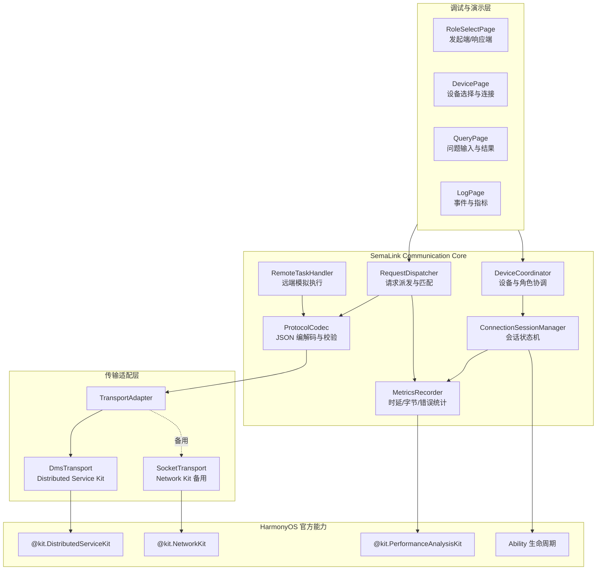
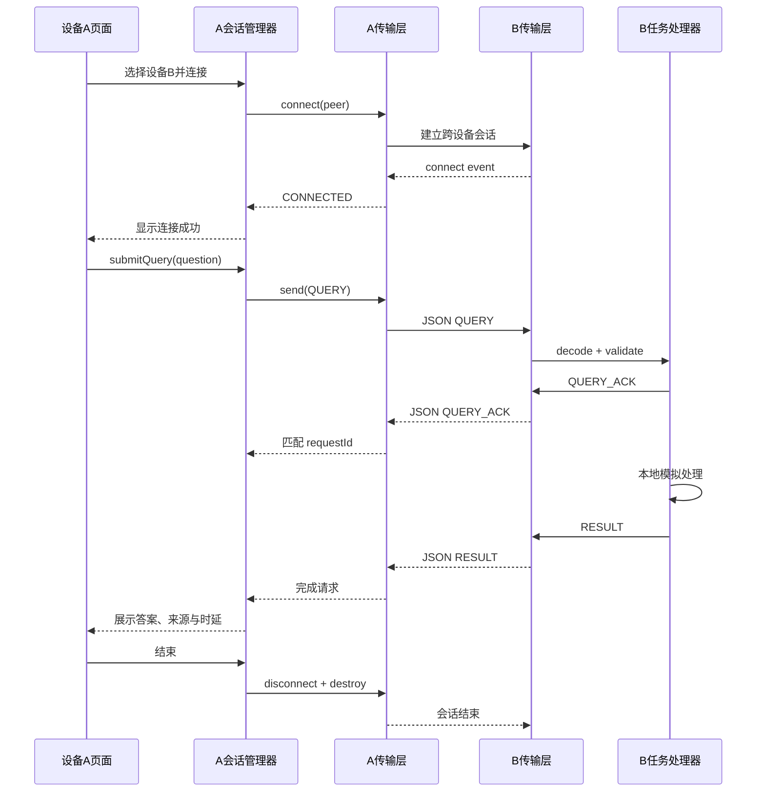

# SemaLink 甲开发架构文档：HarmonyOS 跨设备通信可行性验证

> 版本：POC v0.1  
> 角色：甲  
> 建议分支：`feature/a-cross-device-poc`  
> 建议开发基线：HarmonyOS 6.1.1，`compileSdkVersion 24`  
> 核心能力最低要求：API 18 及以上  
> 文档状态：用于第一阶段技术预研与双设备 Demo 开发

---

## 1. 文档目标

甲的第一阶段任务不是完成完整的跨设备知识问答，而是验证 SemaLink 最关键的底座能力：

> 一台 HarmonyOS 设备能否主动连接另一台安装同一应用的 HarmonyOS 设备，发送自定义查询，并获得对端返回的自定义结果。

本阶段只回答通信可行性，不提前实现知识检索、小艺入口、多设备智能路由和复杂安全体系。

成功演示链路如下：

```text
设备 A 启动 SemaLink
→ 选择设备 B
→ 建立跨设备会话
→ A 发送 JSON 查询
→ B 收到查询并执行模拟任务
→ B 返回 JSON 结果
→ A 展示结果、时延、字节数和日志
→ 双端主动结束会话
```

---

## 2. 官方能力边界与架构决策

### 2.1 首选方案：Distributed Service Kit

首选使用：

```text
@kit.DistributedServiceKit
└── abilityConnectionManager
```

官方跨设备 UIAbility 协同能力可用于：

- 跨设备拉起同一应用的 UIAbility；
- 建立应用间协同会话；
- 监听连接、断开和消息接收事件；
- 双向发送文本消息；
- 结束和销毁协同会话。

本项目第一阶段必须遵守以下约束：

1. 双端系统 API Version 不低于 18；
2. 双端登录同一华为账号；
3. 双端完成设备组网，通常需要开启蓝牙；
4. 双端安装包使用相同 `bundleName`；
5. 普通三方应用首版只按文本消息能力设计；
6. 应用退到后台或锁屏后，协同会话可能受生命周期限制；
7. 设备发现、设备标识获取和相关权限必须通过真机编译验证，不能只凭文档假设可用。

因此，SemaLink 的查询、响应、确认和错误消息统一序列化为 JSON 字符串，通过 `sendMessage()` 传输。

### 2.2 备用方案：Network Kit

若 Distributed Service Kit 在普通参赛应用中出现设备发现接口、权限、签名或审核限制，则保留备用传输适配器：

```text
@kit.NetworkKit
└── TCP Socket / TLS Socket
```

备用方案要求：

- 双端处于同一局域网；
- 通过手动输入 IP、扫码配对或预设地址确定对端；
- TCP 负责可靠传输；
- TLS 作为后续安全增强；
- 不将该方案包装成鸿蒙分布式协同能力，只作为工程保底。

第一轮验收优先验证官方跨设备协同链路，只有确认受限后才切换备用方案。

---

## 3. 甲的责任边界

### 3.1 甲必须完成

1. 双端统一 HAP 工程骨架；
2. 发起端与响应端角色切换；
3. 设备发现或设备选择验证；
4. 跨设备会话创建、连接、接收、断开；
5. JSON 协议编解码；
6. 查询请求发送；
7. 对端模拟任务执行；
8. 查询结果回传；
9. 超时、重复消息、断线和格式错误处理；
10. 通信日志与性能指标记录；
11. 真机测试报告；
12. 对乙提供稳定的通信门面接口。

### 3.2 甲暂不负责

- 小艺智能体和意图接入；
- 文档导入、切片和本地检索；
- OCR 和图片处理；
- ArkData 向量检索；
- 多设备语义路由；
- 大模型生成最终答案；
- 文件、图片和视频传输；
- 完整 TLS 证书体系；
- 后台长期常驻服务；
- 多用户或跨账号协同。

---

## 4. 总体架构



核心设计原则：

- **单一协议，上层无感**：无论底层使用 DMS 还是 Socket，上层都只调用 `TransportAdapter`。
- **同一代码包双角色运行**：双端安装同一 HAP，通过页面选择或设备类型决定当前角色。
- **先文本，后能力扩展**：第一阶段全部消息使用 JSON 文本，不传文件。
- **状态可观测**：连接、请求、响应、失败和断开都必须写入日志。
- **会话及时释放**：任务完成后主动断开并销毁会话，避免资源长期占用。

---

## 5. 核心模块设计

## 5.1 DeviceCoordinator

职责：

- 初始化当前设备信息；
- 记录当前角色；
- 发起设备发现或设备选择；
- 保存目标设备标识；
- 向 `ConnectionSessionManager` 发起连接请求；
- 屏蔽页面对底层设备管理 API 的直接访问。

主要状态：

```ts
enum DeviceRole {
  INITIATOR = 'INITIATOR',
  RESPONDER = 'RESPONDER'
}

interface PeerDevice {
  deviceId: string;
  deviceName: string;
  deviceType?: string;
  online: boolean;
}
```

注意：

- `deviceId` 只在内存中使用；
- UI 日志不得直接显示完整设备标识；
- 持久化时只保存哈希或用户自定义别名；
- 如果普通应用无法直接调用设备发现 API，应立即记录限制，不得尝试申请未开放的系统权限绕过。

## 5.2 ConnectionSessionManager

职责：

- 创建和保存会话 ID；
- 发起或接受跨设备连接；
- 注册事件监听；
- 管理连接状态；
- 处理主动断开与异常断开；
- 在页面退出或 Ability 销毁时释放资源。

状态机：

```text
IDLE
  ↓
DISCOVERING
  ↓
CONNECTING
  ↓
CONNECTED
  ↓
WAITING_ACK
  ↓
WAITING_RESULT
  ↓
COMPLETED
  ↓
CLOSING
  ↓
CLOSED
```

异常状态：

```text
DISCOVERY_FAILED
CONNECT_FAILED
TIMEOUT
PEER_DISCONNECTED
PROTOCOL_ERROR
PERMISSION_DENIED
```

状态转换必须是单向、可追踪的，禁止页面直接修改连接状态。

## 5.3 TransportAdapter

统一接口：

```ts
interface TransportAdapter {
  initialize(): Promise<void>;
  connect(peer: PeerDevice): Promise<void>;
  send(message: string): Promise<void>;
  disconnect(): Promise<void>;
  destroy(): Promise<void>;

  onConnected(callback: () => void): void;
  onMessage(callback: (message: string) => void): void;
  onDisconnected(callback: (reason?: string) => void): void;
  onError(callback: (error: TransportError) => void): void;
}
```

实现一：

```text
DmsTransport
→ createAbilityConnectionSession
→ connect / acceptConnect
→ on('connect')
→ on('receiveMessage')
→ sendMessage
→ disconnect
→ destroyAbilityConnectionSession
```

实现二：

```text
SocketTransport
→ TCP/TLS connect
→ length-prefix framing
→ send
→ message receive
→ close
```

第一阶段只要求 `DmsTransport` 跑通；`SocketTransport` 可以先保留接口和空实现。

## 5.4 ProtocolCodec

职责：

- JSON 序列化与反序列化；
- 协议版本校验；
- 必填字段校验；
- 消息大小限制；
- 非法消息拒绝；
- 兼容后续协议升级。

统一消息信封：

```ts
interface ProtocolEnvelope<T> {
  protocolVersion: '1.0';
  messageId: string;
  sessionId: string;
  requestId?: string;
  type: MessageType;
  timestamp: number;
  sourceAlias: string;
  payload: T;
}
```

消息类型：

```ts
enum MessageType {
  HELLO = 'HELLO',
  HELLO_ACK = 'HELLO_ACK',
  QUERY = 'QUERY',
  QUERY_ACK = 'QUERY_ACK',
  RESULT = 'RESULT',
  ERROR = 'ERROR',
  CANCEL = 'CANCEL',
  PING = 'PING',
  PONG = 'PONG'
}
```

限制建议：

- 单条 JSON 消息不超过 32 KB；
- 问题文本不超过 2000 字；
- 证据片段最多 3 条；
- 单个证据片段不超过 1500 字；
- 日志中问题文本默认截断；
- 不允许消息中携带文件路径、文件原文或账号凭据。

## 5.5 RequestDispatcher

职责：

- 创建唯一 `requestId`；
- 保存待完成请求；
- 发送 `QUERY`；
- 等待 `QUERY_ACK`；
- 根据 `requestId` 匹配 `RESULT`；
- 超时后发送 `CANCEL`；
- 忽略已经完成请求的重复响应。

建议超时：

```text
连接超时：10 秒
QUERY_ACK 超时：3 秒
RESULT 超时：15 秒
PING 超时：3 秒
```

请求模型：

```ts
interface QueryPayload {
  question: string;
  taskType: 'COMMUNICATION_POC';
  maxEvidence: number;
  privacyLevel: 'SUMMARY_ONLY';
  deadlineMs: number;
}
```

响应模型：

```ts
interface ResultPayload {
  answer: string;
  sourceDevice: string;
  evidence: EvidenceItem[];
  processingMs: number;
  isFinal: boolean;
}

interface EvidenceItem {
  title: string;
  snippet: string;
  score: number;
}
```

## 5.6 RemoteTaskHandler

第一阶段不接真实知识库，只执行可确定的模拟任务。

处理流程：

```text
收到 QUERY
→ 校验协议和字段
→ 返回 QUERY_ACK
→ 延迟 100～500 ms 模拟本地处理
→ 生成固定结果与证据
→ 返回 RESULT
```

模拟结果示例：

```json
{
  "answer": "设备 B 已收到问题，并在本地完成模拟检索。",
  "sourceDevice": "HarmonyOS Device B",
  "evidence": [
    {
      "title": "Communication POC",
      "snippet": "该结果由设备 B 本地生成，未传输完整文件。",
      "score": 1.0
    }
  ],
  "processingMs": 180,
  "isFinal": true
}
```

## 5.7 MetricsRecorder

必须记录：

- 设备发现耗时；
- 会话连接耗时；
- 首次 ACK 时延；
- 结果返回总时延；
- 发送字节数；
- 接收字节数；
- 成功请求数；
- 超时数；
- 断线数；
- 协议错误数；
- 重复消息数；
- 当前连接状态。

指标数据仅用于 POC，可先存内存并支持导出 JSON。

---

## 6. 端到端时序



---

## 7. 工程目录建议

```text
entry/src/main/ets/
├── entryability/
│   └── EntryAbility.ets
├── pages/
│   ├── RoleSelectPage.ets
│   ├── DevicePage.ets
│   ├── QueryPage.ets
│   └── LogPage.ets
├── communication/
│   ├── TransportAdapter.ets
│   ├── DmsTransport.ets
│   ├── SocketTransport.ets
│   ├── ConnectionSessionManager.ets
│   └── DeviceCoordinator.ets
├── protocol/
│   ├── MessageTypes.ets
│   ├── ProtocolModels.ets
│   ├── ProtocolCodec.ets
│   └── ProtocolValidator.ets
├── task/
│   ├── RequestDispatcher.ets
│   └── RemoteTaskHandler.ets
├── metrics/
│   ├── MetricsRecorder.ets
│   └── TraceEvent.ets
├── model/
│   ├── PeerDevice.ets
│   └── ConnectionState.ets
└── common/
    ├── AppError.ets
    ├── IdGenerator.ets
    └── Logger.ets
```

约束：

- 页面不能直接调用 Distributed Service Kit；
- 协议对象不能依赖 UI；
- `RemoteTaskHandler` 不得写在 `EntryAbility` 中；
- 所有事件监听必须有对应注销逻辑；
- 会话 ID 不允许作为全局裸变量散落在多个页面。

---

## 8. Ability 生命周期设计

响应端通过跨设备协同被拉起后，应在 `UIAbility` 的协同生命周期入口中完成：

1. 读取协同参数；
2. 创建本端会话；
3. 注册连接、断开和消息监听；
4. 接受连接；
5. 将会话交给 `ConnectionSessionManager`；
6. 页面只订阅状态，不处理底层回调。

退出规则：

- 用户点击结束：主动断开并销毁；
- 页面销毁：注销监听；
- 对端断开：清理待处理请求；
- Ability 销毁：释放传输层；
- 重复触发协同：检查旧会话，禁止同时覆盖。

后台限制必须单独测试。POC 不默认申请长时任务，先如实记录前后台和锁屏行为；只有场景确实需要时，再评估 Background Tasks Kit。

---

## 9. 错误处理

统一错误模型：

```ts
interface TransportError {
  code: string;
  message: string;
  recoverable: boolean;
  cause?: string;
}
```

主要错误码：

| 错误码 | 含义 | 处理 |
|---|---|---|
| `E_DEVICE_NOT_FOUND` | 未发现目标设备 | 提示检查账号、蓝牙和组网 |
| `E_CONNECT_TIMEOUT` | 建连超时 | 允许重新连接 |
| `E_CONNECT_DENIED` | 权限或系统限制 | 记录完整错误，停止重试 |
| `E_PEER_OFFLINE` | 对端离线 | 返回设备选择页 |
| `E_PROTOCOL_INVALID` | JSON 或字段非法 | 丢弃消息并返回 ERROR |
| `E_REQUEST_TIMEOUT` | 结果超时 | 发送 CANCEL |
| `E_DUPLICATE_MESSAGE` | 重复消息 | 幂等忽略 |
| `E_SESSION_CLOSED` | 会话已关闭 | 禁止继续发送 |
| `E_BACKGROUND_INTERRUPTED` | 后台导致中断 | 记录测试条件 |

禁止无限重连。第一阶段最多自动重试一次，随后由用户手动重新连接。

---

## 10. 开发阶段与交付物

## P0：环境与权限验证

目标：

- 工程升级到 API 24 编译；
- 两台真机安装同一 HAP；
- 确认 `bundleName`、模块名和 Ability 名一致；
- 确认双端同账号、蓝牙开启、设备组网成功；
- 编译 Distributed Service Kit 示例调用；
- 记录哪些接口是公开 API，哪些接口受系统权限限制。

交付物：

- `API_Feasibility_Matrix.md`
- 双端环境截图
- 编译日志
- 设备组网检查结果

## P1：单机协议闭环

目标：

- 完成协议模型和编解码；
- 本地模拟收发；
- 完成请求匹配、超时和错误处理。

验收：

- 100 条协议单元测试通过；
- 非法 JSON 不导致崩溃；
- 重复 `RESULT` 不重复完成请求。

## P2：双设备连接

目标：

- 设备 A 发起协同；
- 设备 B 被拉起；
- 双端收到连接事件；
- 支持主动断开和重新连接。

验收：

- 连续连接 10 次成功；
- 每次结束后无残留会话；
- 错误状态可在页面看到。

## P3：双向文本通信

目标：

- A 向 B 发送 `HELLO`；
- B 返回 `HELLO_ACK`；
- 双端可发送 `PING/PONG`；
- 日志显示消息方向、类型、大小和时间。

验收：

- 连续发送 100 条短消息；
- 消息类型与 `messageId` 匹配正确；
- 无页面卡死和应用崩溃。

## P4：模拟查询闭环

目标：

- A 发送 `QUERY`；
- B 返回 `QUERY_ACK`；
- B 本地执行模拟任务；
- A 接收并展示 `RESULT`。

验收：

- 页面显示来源设备；
- 页面显示处理时延与传输字节；
- 结果只包含摘要和证据片段；
- 不传完整文件。

## P5：异常与生命周期验证

测试：

- 对端应用未启动；
- 对端设备离线；
- 蓝牙关闭；
- WLAN 变化；
- 应用切后台；
- 锁屏；
- 连接中退出页面；
- 返回非法 JSON；
- 重复发送同一请求；
- 处理中断开连接。

交付物：

- `CrossDevice_Test_Report.md`
- 失败日志
- 已知限制清单
- 是否需要长时任务的结论

---

## 11. 验收标准

首轮 POC 满足以下条件即可判定通信主链路成立：

1. 两台 HarmonyOS 真机安装同一 SemaLink HAP；
2. 设备 A 能连接并拉起设备 B 的对应 UIAbility；
3. A 能发送自定义 JSON 问题；
4. B 能解析问题并返回自定义 JSON 结果；
5. A 能根据 `requestId` 正确匹配结果；
6. 连接、请求和响应全过程有日志；
7. 任务完成后会话可主动释放；
8. 连续执行 20 次查询成功率不低于 95%；
9. 前台场景首个结果总时延目标小于 3 秒；
10. 单次任务不传完整文件，文本传输量可测量；
11. 锁屏、后台和断网行为有明确测试结论；
12. 所有受限 API、权限和设备要求均写入可行性矩阵。

注意：3 秒是项目 POC 目标，不是官方性能承诺。

---

## 12. 与乙的接口约定

甲完成通信底座后，对乙只暴露以下门面：

```ts
interface CrossDeviceClient {
  listPeers(): Promise<PeerDevice[]>;
  connect(peerId: string): Promise<void>;
  execute(request: CrossDeviceTaskRequest): Promise<CrossDeviceTaskResult>;
  cancel(requestId: string): Promise<void>;
  disconnect(): Promise<void>;
  getMetrics(): CommunicationMetrics;
}
```

乙后续负责把模拟任务替换为真实能力，例如：

```text
QUERY
→ 本地文档检索
→ 生成摘要和证据
→ RESULT
```

乙不得直接调用 `abilityConnectionManager`，也不得自行定义另一套跨设备协议。

---

## 13. 风险与决策门

### 决策门 A：官方协同链路完全可用

结论：

- 保留 `DmsTransport` 作为正式底座；
- 进入真实本地检索和设备语义路由阶段；
- 项目可以突出 HarmonyOS 原生分布式协同。

### 决策门 B：能连接，但设备发现接口受限

处理：

- 优先寻找官方设备选择流程；
- POC 可暂时使用测试设备 ID 注入，但必须标注只用于调试；
- 不将“自动发现任意设备”写入正式能力；
- 继续向华为官方或赛事技术支持确认开放边界。

### 决策门 C：只能前台稳定工作

处理：

- MVP 明确要求双端前台；
- 演示流程避免锁屏和长期后台；
- 后续再评估长时任务，不把后台常驻作为首版承诺。

### 决策门 D：普通三方应用无法完成目标链路

处理：

- 切换 `SocketTransport`，在同一局域网完成通信 POC；
- 在技术报告中如实说明官方分布式接口限制；
- 重新评估题目是否仍能定位为系统级协同创新；
- 不申请或伪装使用系统权限。

---

## 14. 最终交付清单

甲完成第一阶段后必须提交：

```text
1. 可运行的双设备 SemaLink HAP
2. feature/a-cross-device-poc 分支源码
3. API_Feasibility_Matrix.md
4. CrossDevice_Test_Report.md
5. 协议定义与接口文档
6. 双端连接与查询演示视频
7. 前后台、锁屏和断网测试结果
8. 关键日志与性能指标 JSON
9. 已知限制与下一阶段建议
```

---

## 15. 一句话验收演示

> 在设备 A 输入“测试跨设备查询”，设备 A 通过 HarmonyOS 原生跨设备协同连接设备 B；设备 B 本地生成模拟证据，只返回摘要文本；设备 A 显示结果来源、连接时延、响应时延和传输字节，随后主动结束会话。

---

## 16. 官方文档核对清单

开发前后均需在华为开发者联盟文档中心核对：

- 《跨设备连接 UIAbility 开发指南》
- 《Distributed Service Kit 简介》
- 《分布式设备管理开发指南》
- 《abilityConnectionManager API 参考》
- 《Socket 连接》
- 《同应用跨设备数据同步概述》
- 《OS 新增和增强特性：6.1.1(24)》

任何接口、权限、支持设备和生命周期结论，均以当前 SDK 编译结果、真机行为和最新官方文档为准。
