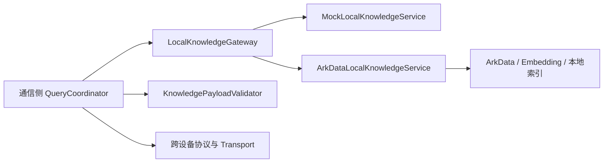
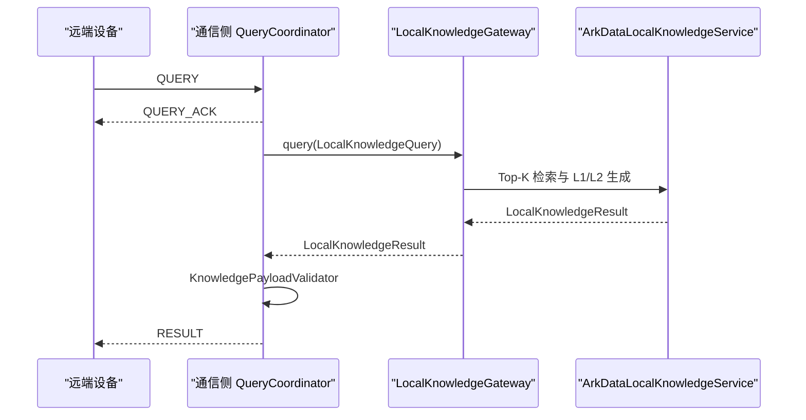

# SemaLink 本地知识公用层接口设计

> 日期：2026-07-14
> 状态：设计已批准
> 契约版本：`1.0`
> 适用范围：通信模块与单机知识检索模块的对接

## 1. 文档目标

本文档定义 SemaLink 通信模块与本地知识检索模块之间唯一稳定的公用层契约。

队友负责在单台 HarmonyOS 设备上完成测试文档导入、索引、Top-K 检索、L1 摘要、L2 命中段落和本机知识画像生成。通信侧负责构造查询、调用公用接口、校验结果、映射跨设备协议和传输数据。

本契约只暴露查询和画像读取，不暴露文档导入、索引更新或 ArkData 内部对象。

## 2. 设计原则

- **独立领域契约**：公用层不依赖 ArkData、ArkUI、`abilityConnectionManager` 或具体 Transport。
- **单向依赖**：通信实现和知识实现都依赖公用层，公用层不反向依赖任一实现。
- **强类型请求**：查询、过滤、画像和错误均使用明确字段，不使用任意 `Record<string, Object>`。
- **固定 JSON schema**：L1/L2 结果通过字符串传递，但字符串内容必须符合本文定义的 schema。
- **预算先行**：检索结果同时受 `topK` 和 `maxPayloadBytes` 限制。
- **隐私最小化**：公用结果不包含文件 URI、本地路径、完整文件、Embedding 或数据库内部主键。
- **替换实现无感**：`MockLocalKnowledgeService` 与 `ArkDataLocalKnowledgeService` 实现同一个接口。

## 3. 模块边界



### 3.1 目录边界

```text
entry/src/main/ets/
├── contracts/knowledge/
│   ├── LocalKnowledgeGateway.ets
│   ├── KnowledgeModels.ets
│   ├── KnowledgePayloadSchemas.ets
│   ├── KnowledgePayloadValidator.ets
│   └── KnowledgeError.ets
├── communication/
├── knowledge/
└── application/
```

第一版在同一个 `entry` 模块内使用独立目录，不创建单独工程或 HAR。未来确实需要跨 HAP 或跨仓库复用时，再将 `contracts/knowledge` 提取为 HAR。

### 3.2 所有权

| 范围 | 责任方 | 职责 |
|---|---|---|
| 公用契约 | 双方共同维护 | 接口、模型、schema、Validator、错误码和契约测试 |
| 通信模块 | 通信侧 | 请求构造、结果校验、协议映射、会话和传输 |
| 本地知识模块 | 队友 | 导入、索引、Top-K、L1/L2 序列化和知识画像 |
| Mock 实现 | 通信侧 | 在真实检索接入前验证调用链和跨设备链路 |
| ArkData 实现 | 队友 | 实现真实 `LocalKnowledgeGateway` |

约束：

- 通信侧不得读取 ArkData 表、文档 URI、查询向量或检索内部对象。
- 队友模块不得直接创建跨设备会话，也不得自行定义另一套 QUERY/RESULT 协议。
- 公用层不得导入通信模块、ArkData 实现、页面或 Ability。

## 4. 公用接口

```ts
export interface LocalKnowledgeGateway {
  query(request: LocalKnowledgeQuery): Promise<LocalKnowledgeResult>;
  getKnowledgeProfile(): Promise<KnowledgeProfile>;
}
```

接口语义：

- `query()` 执行一次本地知识查询，返回调用方指定的 L1 或 L2 结果。
- `getKnowledgeProfile()` 按需返回当前本地知识和索引画像。
- 第一版不提供文档导入、更新、删除和画像订阅接口。
- 第一版调用方负责串行化跨设备请求；本契约不承诺并发调度行为。

## 5. 查询请求

```ts
export type KnowledgeContractVersion = '1.0';
export type KnowledgePayloadLevel = 'L1' | 'L2';
export type KnowledgeModality = 'text' | 'pdf' | 'image' | 'ocr_text';

export interface KnowledgeQueryFilters {
  documentIds?: string[];
  tags?: string[];
  modalities?: KnowledgeModality[];
  updatedAfter?: number;
}

export interface LocalKnowledgeQuery {
  contractVersion: KnowledgeContractVersion;
  requestId: string;
  queryText: string;
  topK: number;
  requestedLevel: KnowledgePayloadLevel;
  maxPayloadBytes: number;
  filters?: KnowledgeQueryFilters;
}
```

### 5.1 字段约束

| 字段 | 约束 |
|---|---|
| `contractVersion` | 第一版固定为 `1.0` |
| `requestId` | 非空，在一次调用链中唯一；结果必须原样返回 |
| `queryText` | 去除首尾空白后为 1～1000 字符 |
| `topK` | 1～20；建议调用值为 5 |
| `requestedLevel` | 本次结果全部使用 L1 或全部使用 L2，不混合 |
| `maxPayloadBytes` | 1 KiB～256 KiB；按 `payloadJson` 的 UTF-8 字节数计算 |
| `filters.documentIds` | 最多 100 项；空数组等同于未设置 |
| `filters.tags` | 最多 20 项；单项去除首尾空白后为 1～64 字符 |
| `filters.modalities` | 仅允许 `KnowledgeModality` 中的值，不允许重复 |
| `filters.updatedAfter` | 非负 Unix 毫秒时间戳 |

参数校验必须在访问 ArkData 或执行 Embedding 前完成。

## 6. 查询结果外壳

```ts
export interface LocalKnowledgeResult {
  contractVersion: KnowledgeContractVersion;
  requestId: string;
  level: KnowledgePayloadLevel;
  itemCount: number;
  payloadJson: string;
  truncated: boolean;
  retrievalMs: number;
  indexVersion: string;
  generatedAt: number;
}
```

### 6.1 字段约束

- `requestId` 必须与请求一致。
- `level` 必须与 `requestedLevel` 一致。
- `itemCount` 必须等于 `payloadJson.items.length`。
- `payloadJson` 必须是语法完整且符合 L1/L2 schema 的 JSON 字符串。
- `payloadJson` 的 UTF-8 字节数不得超过请求的 `maxPayloadBytes`。
- `truncated=true` 表示因 `topK`、字节预算或单项长度上限减少了内容。
- `retrievalMs` 是从进入真实检索逻辑到完成 payload 生成的毫秒数，必须为非负数。
- `indexVersion` 必须标识本次查询实际使用的索引快照。
- `generatedAt` 使用 Unix 毫秒时间戳。
- 无命中不是错误，返回 `itemCount=0` 和合法空 `items`。

检索模块必须同时满足 `topK` 和 `maxPayloadBytes`。不能先生成超大 JSON 再截断字符串，因为这会破坏 JSON 语法和 schema。

## 7. L1 JSON Schema

L1 表示文档级摘要，用于快速筛选和首结果展示。

```ts
export interface L1KnowledgePayload {
  schemaVersion: '1.0';
  level: 'L1';
  items: L1KnowledgeItem[];
}

export interface L1KnowledgeItem {
  evidenceId: string;
  documentId: string;
  title: string;
  summary: string;
  tags: string[];
  relevance: number;
  updatedAt: number;
}
```

约束：

- `summary` 最多 300 字符。
- `relevance` 范围为 `0.0～1.0`。
- `items` 按 `relevance` 降序排列。
- `evidenceId` 在当前结果内唯一。
- `documentId` 是队友模块生成的稳定业务 ID。
- `updatedAt` 使用 Unix 毫秒时间戳。

示例：

```json
{
  "schemaVersion": "1.0",
  "level": "L1",
  "items": [
    {
      "evidenceId": "ev-doc-001",
      "documentId": "doc-001",
      "title": "SemaLink 测试报告",
      "summary": "报告记录了跨设备通信成功率与首结果时延。",
      "tags": ["测试报告", "HarmonyOS"],
      "relevance": 0.94,
      "updatedAt": 1784025600000
    }
  ]
}
```

## 8. L2 JSON Schema

L2 表示命中段落，用于返回与问题直接相关的文本证据。

```ts
export interface L2KnowledgePayload {
  schemaVersion: '1.0';
  level: 'L2';
  items: L2KnowledgeItem[];
}

export interface L2KnowledgeItem {
  evidenceId: string;
  documentId: string;
  chunkId: string;
  title: string;
  snippet: string;
  relevance: number;
  page?: number;
  startOffset?: number;
  endOffset?: number;
  truncated: boolean;
}
```

约束：

- `snippet` 最多 1500 字符。
- `relevance` 范围为 `0.0～1.0`。
- `items` 按 `relevance` 降序排列。
- `evidenceId` 在当前结果内唯一。
- `documentId` 和 `chunkId` 是稳定业务 ID，不得使用数据库内部 row ID。
- `page` 使用从 1 开始的页码。
- `startOffset/endOffset` 是文档规范化文本中的字符偏移。
- 页码或偏移未知时省略字段，不使用 `-1`。
- `truncated=true` 表示 `snippet` 因单项上限或总字节预算被缩短。

示例：

```json
{
  "schemaVersion": "1.0",
  "level": "L2",
  "items": [
    {
      "evidenceId": "ev-chunk-014",
      "documentId": "doc-001",
      "chunkId": "chunk-014",
      "title": "SemaLink 测试报告",
      "snippet": "连续执行 20 次查询，成功率为 95%，首结果平均时延为 1.8 秒。",
      "relevance": 0.97,
      "page": 6,
      "startOffset": 4120,
      "endOffset": 4161,
      "truncated": false
    }
  ]
}
```

### 8.1 通用 payload 约束

L1/L2 JSON 均不得包含：

- 文件 URI 或本地路径；
- 完整文件内容；
- Embedding 向量；
- ArkData 表名、row ID 或内部索引键；
- 账号、凭据或其他设备身份信息。

无命中时仍返回对应 level 的合法空 payload：

```json
{
  "schemaVersion": "1.0",
  "level": "L1",
  "items": []
}
```

## 9. KnowledgeProfile

```ts
export type KnowledgeIndexState = 'EMPTY' | 'BUILDING' | 'READY' | 'ERROR';
export type RetrievalMode = 'keyword' | 'vector' | 'hybrid';

export interface KnowledgeDomain {
  tag: string;
  weight: number;
  documentCount: number;
}

export interface KnowledgeProfile {
  contractVersion: '1.0';
  profileVersion: string;
  indexState: KnowledgeIndexState;
  knowledgeDomains: KnowledgeDomain[];
  documentCount: number;
  chunkCount: number;
  modalities: KnowledgeModality[];
  retrievalModes: RetrievalMode[];
  supportedLevels: KnowledgePayloadLevel[];
  indexVersion: string;
  embeddingModelVersion: string;
  updatedAt: number;
}
```

### 9.1 画像约束

- 画像只描述本地知识与索引，不包含设备 ID、电量、CPU、网络或 RTT。
- `knowledgeDomains` 最多 20 项，按 `weight` 降序排列。
- `weight` 范围为 `0.0～1.0`。
- `documentCount`、`chunkCount` 和域内 `documentCount` 必须为非负整数。
- `profileVersion` 在画像内容变化时更新，用于通信侧缓存失效判断。
- `indexVersion` 标识当前索引快照。
- 不使用向量检索时，`embeddingModelVersion` 为空字符串。
- 无文档时返回 `indexState='EMPTY'`、计数 0 和空知识域，不抛异常。
- 索引构建期间返回 `BUILDING`。
- 第一版只支持按需调用，不提供画像订阅。

示例：

```json
{
  "contractVersion": "1.0",
  "profileVersion": "profile-20260714-03",
  "indexState": "READY",
  "knowledgeDomains": [
    { "tag": "HarmonyOS", "weight": 0.91, "documentCount": 18 },
    { "tag": "测试报告", "weight": 0.84, "documentCount": 7 }
  ],
  "documentCount": 25,
  "chunkCount": 386,
  "modalities": ["text", "pdf", "ocr_text"],
  "retrievalModes": ["keyword", "vector", "hybrid"],
  "supportedLevels": ["L1", "L2"],
  "indexVersion": "index-20260714-09",
  "embeddingModelVersion": "text-embedding-ms-v1",
  "updatedAt": 1784025600000
}
```

## 10. 错误契约

```ts
export type KnowledgeErrorCode =
  | 'E_CONTRACT_VERSION_UNSUPPORTED'
  | 'E_QUERY_INVALID'
  | 'E_TOP_K_INVALID'
  | 'E_PAYLOAD_BUDGET_INVALID'
  | 'E_FILTER_INVALID'
  | 'E_INDEX_NOT_READY'
  | 'E_RETRIEVAL_FAILED'
  | 'E_PAYLOAD_INVALID';

export class KnowledgeError extends Error {
  readonly code: KnowledgeErrorCode;
  readonly recoverable: boolean;
  readonly retryAfterMs?: number;
}
```

| 错误码 | 场景 | 可恢复 |
|---|---|---|
| `E_CONTRACT_VERSION_UNSUPPORTED` | 不支持请求中的 `contractVersion` | 否 |
| `E_QUERY_INVALID` | 问题为空或超过 1000 字符 | 是 |
| `E_TOP_K_INVALID` | `topK` 不在 1～20 | 是 |
| `E_PAYLOAD_BUDGET_INVALID` | 字节预算不在 1 KiB～256 KiB | 是 |
| `E_FILTER_INVALID` | 过滤字段类型、数量或取值非法 | 是 |
| `E_INDEX_NOT_READY` | 索引正在构建或不可查询 | 是 |
| `E_RETRIEVAL_FAILED` | ArkData、Embedding 或重排失败 | 视原始错误 |
| `E_PAYLOAD_INVALID` | 生成的 L1/L2 JSON 不符合 schema | 否 |

规则：

- Promise rejection 必须使用 `KnowledgeError`。
- 不得向通信侧泄漏数据库异常对象、文件路径、查询向量或内部堆栈。
- `E_INDEX_NOT_READY` 可携带 `retryAfterMs`，但通信侧不自动重试。
- 无命中不是错误。
- 通信侧将错误映射为跨设备 ERROR 时保留 `code` 和安全的用户消息。

## 11. Validator 契约

`KnowledgePayloadValidator` 是公用层的一部分，由通信侧和知识侧测试共同使用。

```ts
export interface KnowledgePayloadValidator {
  validateResult(
    request: LocalKnowledgeQuery,
    result: LocalKnowledgeResult
  ): void;

  validateProfile(profile: KnowledgeProfile): void;
}
```

`validateResult()` 必须检查：

1. `contractVersion`、`requestId` 和 level 一致；
2. `payloadJson` UTF-8 字节数不超过预算；
3. JSON 可解析，`schemaVersion='1.0'`；
4. root level 与请求一致；
5. `items.length === itemCount`；
6. item 必填字段、类型和长度；
7. `relevance` 范围与排序；
8. `evidenceId` 唯一；
9. 禁止字段和疑似本地路径不出现。

校验失败抛出 `E_PAYLOAD_INVALID`。双方不得通过类型断言绕过 Validator。

## 12. 通信层映射

公用层不导入跨设备 `ProtocolEnvelope`。通信侧负责映射。

### 12.1 QUERY 映射

```ts
export interface CrossDeviceKnowledgeQueryPayload {
  contractVersion: '1.0';
  queryText: string;
  topK: number;
  requestedLevel: 'L1' | 'L2';
  maxPayloadBytes: number;
  filters?: KnowledgeQueryFilters;
}
```

映射规则：

- `ProtocolEnvelope.requestId` 映射为 `LocalKnowledgeQuery.requestId`。
- 通信侧根据消息上限预留信封开销后计算 `maxPayloadBytes`。
- 当前 16 KiB 文本消息可先为知识 payload 分配约 12 KiB，最终值以 UTF-8 编码测量为准。
- 响应端先发送 `QUERY_ACK`，再调用 `LocalKnowledgeGateway.query()`。

### 12.2 RESULT 映射

```ts
export interface CrossDeviceKnowledgeResultPayload {
  resultType: 'KNOWLEDGE';
  sourceDeviceAlias: string;
  knowledgeResult: LocalKnowledgeResult;
}
```

通信侧收到本地结果后必须先调用 Validator，再编码为跨设备 RESULT。`payloadJson` 作为 JSON 字符串字段嵌入结果，必须将转义开销计入最终消息大小。

### 12.3 知识画像映射

通信侧按需调用 `getKnowledgeProfile()`，自行补充设备别名、连接状态和网络指标。第一版不新增画像订阅，也不通过 QUERY/RESULT 偷传画像。未来增加设备路由时，应单独设计 `PROFILE` 消息。

## 13. 调用时序



错误时序：

```text
LocalKnowledgeGateway.query()
  → reject KnowledgeError
  → QueryCoordinator 映射安全错误
  → 发送跨设备 ERROR
```

## 14. 契约测试

双方共用同一测试套件：

```ts
runLocalKnowledgeGatewayContract(
  'MockLocalKnowledgeService',
  () => createMockGateway()
);

runLocalKnowledgeGatewayContract(
  'ArkDataLocalKnowledgeService',
  () => createArkDataGateway(testDatabase)
);
```

必测用例：

- 合法 L1 查询返回固定 schema，单项摘要不超过 300 字符；
- 合法 L2 查询返回固定 schema，单项段落不超过 1500 字符；
- `topK=1` 与 `topK=20` 正常，0 和 21 返回 `E_TOP_K_INVALID`；
- `maxPayloadBytes` 生效，JSON 始终完整，预算不足时 `truncated=true`；
- 结果按 `relevance` 降序排列；
- 四类强类型过滤均生效；
- 无命中返回合法空 `items`；
- L1/L2 不包含 URI、本地路径、完整文件或 Embedding；
- `requestId` 原样返回，`indexVersion` 与实际索引一致；
- `BUILDING` 状态查询返回 `E_INDEX_NOT_READY`；
- 画像在 EMPTY、BUILDING、READY、ERROR 状态均符合 schema；
- 不支持的版本返回 `E_CONTRACT_VERSION_UNSUPPORTED`；
- 非法 JSON 或 schema 不匹配被 Validator 拒绝。

## 15. 联调验收

双方至少联调以下场景：

1. `topK=5` 的 L1 查询；
2. `topK=5` 的 L2 查询；
3. 过滤后无命中；
4. 索引处于 BUILDING；
5. 字节预算导致结果截断；
6. 通信侧使用 Mock 实现跑通同一套流程；
7. composition root 将 Mock 替换为 ArkData 实现后，无需修改 `QueryCoordinator`。

交付物：

- 队友交付 `ArkDataLocalKnowledgeService` 和真实实现契约测试报告；
- 通信侧交付 `MockLocalKnowledgeService`、Validator 和协议映射测试；
- 公用契约变更必须先修改本文档和契约测试，再修改任一实现。

## 16. 版本兼容

- `contractVersion` 与 payload `schemaVersion` 第一版均为 `1.0`。
- 增加可选字段可以保持同一主版本。
- 删除字段、修改字段类型或改变字段语义必须升级主版本。
- Validator 必须检查所有必填字段。
- 遇到未知可选字段时忽略，以支持向前兼容。
- 双方不得在未更新文档和契约测试时自行改变 schema。

## 17. 范围排除

本契约不包含：

- 文档导入、更新和删除 API；
- ArkData 表结构、向量索引和 Embedding 实现；
- UI、Ability 或 Transport 生命周期；
- L3 原文件传输；
- 任意 JSON schema；
- 画像订阅或跨设备 PROFILE 消息；
- 自动重试、并发调度和多设备路由。

## 18. 实施门禁

本文档是设计契约，不包含实现代码。双方审阅并确认书面规格后，下一步使用 `writing-plans` skill 制定公用层接口、Validator、Mock 实现和契约测试的实施计划。
