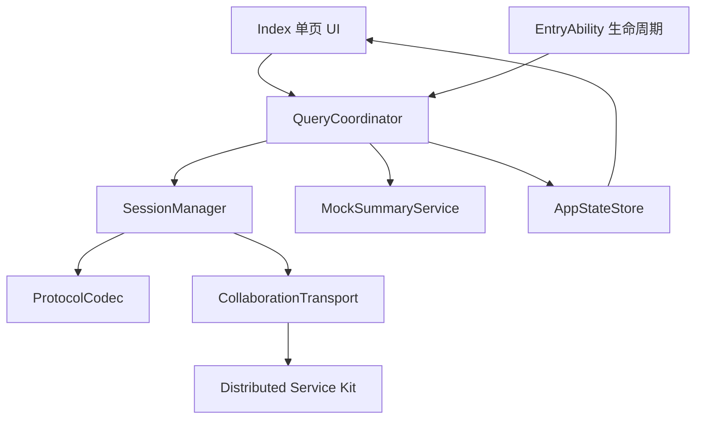
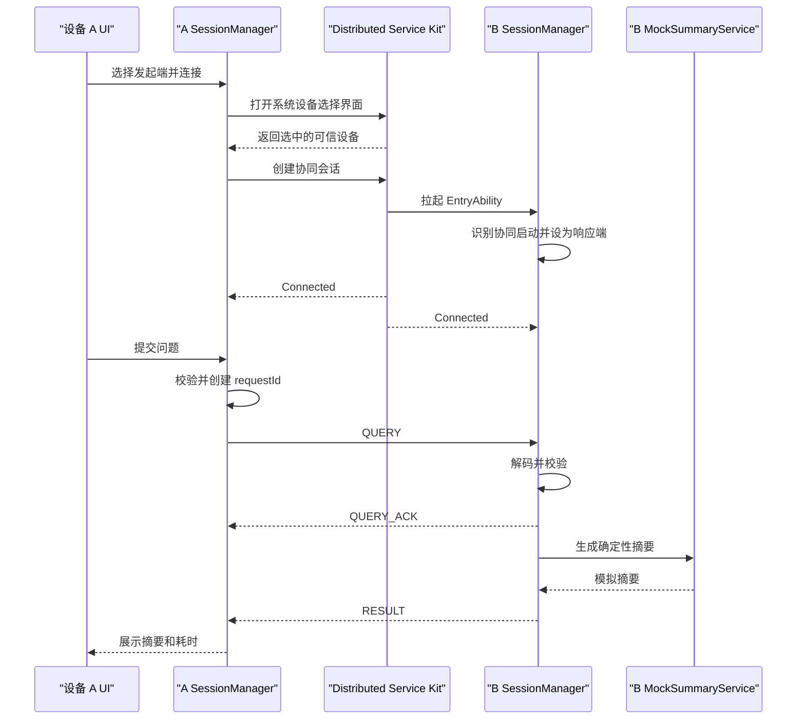

# SemaLink 跨设备通信 MVP 设计

> 日期：2026-07-14
> 状态：设计已批准
> 目标环境：HarmonyOS NEXT ArkTS、API 24、现有 `entry` 模块

## 1. 目标

本 MVP 用于验证一条完整的端到端链路：手机向另一台可信 HarmonyOS 设备发送知识查询，对端收到查询后生成确定性的模拟摘要，并将摘要返回手机。发起请求前，对端应用可以处于未运行状态，系统必须能够通过跨设备协同流程将其拉起。

MVP 仅支持两台设备，不接入小艺，不执行真实文档检索，不传输完整文件，也不引入局域网 Socket 通信链路。允许使用模拟数据验证通信链路。

## 2. 已确认的产品决策

- 两台设备登录同一华为账号，使用相同 `bundleName`，并完成可信设备组网。
- `Distributed Service Kit` 是 MVP 唯一的通信底座，`Network Kit` 留待后续扩展。
- 通过系统设备选择界面选择对端，应用不实现自有设备发现 UI。
- 同一个 HAP 支持手动选择发起端或响应端；通过协同流程拉起时自动进入响应端模式。
- 一次连接可顺序执行多个查询，同一时刻最多存在一个未完成请求。
- 失败后不自动重连或重发，由用户决定是否恢复。
- MVP 使用单页 UI 展示角色、连接、查询、结果、状态和错误。
- 验收要求为同一会话内连续 10 次查询全部成功，并完成一次断线后的手动恢复。

## 3. 总体架构



系统只有一条业务链路和一种传输实现。保留窄接口形式的传输边界，以便后续增加 `SocketTransport` 时无需修改查询用例和协议对象。MVP 不创建空的 Socket 实现，也不提供运行时传输切换逻辑。

### 3.1 模块边界

| 模块 | 职责 | 依赖 | 禁止承担的职责 |
|---|---|---|---|
| `Index.ets` | 提供角色选择、连接操作、问题输入、摘要、状态和可操作的错误提示 | `QueryCoordinator`、`AppStateStore` | 直接调用系统通信 API 或修改会话状态 |
| `EntryAbility` | 识别普通启动与协同启动，并转发生命周期事件 | `QueryCoordinator` | 解析协议消息或生成摘要 |
| `QueryCoordinator` | 提供连接、提交和断开用例，并路由请求与响应 | `SessionManager`、`MockSummaryService`、`AppStateStore` | 直接调用 `Distributed Service Kit` |
| `SessionManager` | 管理会话状态、监听器、计时器、待处理请求、结果缓存、消息收发和资源清理 | `Transport`、`ProtocolCodec` | 渲染 UI 或实现模拟检索 |
| `CollaborationTransport` | 将 `Distributed Service Kit` 回调适配为应用传输事件 | `Distributed Service Kit` | 解释业务 payload |
| `ProtocolCodec` | 编码、解码、消息大小检查和协议信封校验 | 协议模型 | 执行业务决策或重试决策 |
| `MockSummaryService` | 根据合法问题生成确定性摘要 | 无 | 读取文件、数据库或网络 |
| `AppStateStore` | 保存可观察的角色、连接、请求、结果、耗时和错误状态 | 应用模型 | 持有系统资源或计时器 |

建议源码目录：

```text
entry/src/main/ets/
|-- entryability/EntryAbility.ets
|-- pages/Index.ets
|-- application/QueryCoordinator.ets
|-- communication/
|   |-- Transport.ets
|   |-- CollaborationTransport.ets
|   `-- SessionManager.ets
|-- protocol/
|   |-- ProtocolModels.ets
|   `-- ProtocolCodec.ets
|-- task/MockSummaryService.ets
|-- state/AppStateStore.ets
`-- common/
    |-- AppError.ets
    |-- IdGenerator.ets
    `-- Logger.ets
```

## 4. 数据模型与协议

所有跨设备内容均使用 UTF-8 JSON 文本。消息不得包含文件、URI、本地文件路径、二进制内容、账号凭据或完整文档内容。

```ts
type MessageType = 'QUERY' | 'QUERY_ACK' | 'RESULT' | 'ERROR';

interface ProtocolEnvelope<T> {
  version: '1.0';
  type: MessageType;
  messageId: string;
  sessionId: string;
  requestId: string;
  sentAt: number;
  payload: T;
}

interface QueryPayload {
  question: string;
}

interface QueryAckPayload {
  acceptedAt: number;
}

interface ResultPayload {
  summary: string;
  sourceDeviceAlias: string;
  processingMs: number;
}

interface ErrorPayload {
  code: string;
  message: string;
}
```

协议规则：

- `messageId` 唯一标识一条消息。
- `requestId` 用于关联 `QUERY`、`QUERY_ACK`、`RESULT` 和 `ERROR`。
- 发起端在协同会话连接成功时创建 `sessionId`。响应端将第一个合法 `QUERY.sessionId` 绑定到当前传输会话，后续消息必须使用相同值。
- `sentAt` 和 `acceptedAt` 使用 Unix 毫秒时间戳。
- `question` 去除首尾空白后长度必须为 1 至 1000 个字符。
- `summary` 最多包含 2000 个字符。
- 编码后的单条消息不得超过 16 KiB。
- 未知协议版本、未知消息类型、非法 JSON，以及字段缺失或无效，均视为协议错误。
- 日志只记录消息类型、ID、字节数、阶段和耗时，不记录完整问题、完整摘要、设备 ID 或账号数据。

确定性摘要模板：

```text
设备 B 已收到关于“{安全截断后的问题}”的查询。
这是由远端设备生成的模拟摘要，未执行真实文档检索，也未传输完整文件。
```

界面文案可以本地化，但相同的规范化输入必须生成相同的摘要内容。

### 4.1 应用状态

```ts
type DeviceRole = 'UNSELECTED' | 'INITIATOR' | 'RESPONDER';

type ConnectionState =
  | 'IDLE'
  | 'SELECTING_DEVICE'
  | 'CONNECTING'
  | 'CONNECTED'
  | 'WAITING_ACK'
  | 'WAITING_RESULT'
  | 'DISCONNECTING'
  | 'DISCONNECTED'
  | 'ERROR';
```

只有 `SessionManager` 可以发起连接状态转换。UI 只调用命令并渲染 `AppStateStore` 中的状态。

## 5. 通信流程



### 5.1 连接流程

1. 普通启动时角色为 `UNSELECTED`，用户选择发起端。
2. 点击连接后打开系统设备选择界面。
3. 用户取消选择时返回 `IDLE`，不将其报告为通信错误。
4. 用户选中设备后创建协同会话，连接超时为 10 秒。
5. 系统拉起对端，`EntryAbility` 识别协同启动并自动进入响应端模式。
6. 两端进入 `CONNECTED`，连接保持打开，以支持顺序执行多个查询。

实现前必须根据 API 24 SDK 和双真机可行性测试确认具体启动参数及 `Distributed Service Kit` 调用顺序。本文档确定职责归属和预期行为，但不将尚未验证的 API 签名视为既定事实。

### 5.2 查询流程

1. 只有在 `CONNECTED` 且不存在未完成请求时，发起端才允许提交问题。
2. 发起端校验问题，创建 `requestId`，发送 `QUERY`，并进入 `WAITING_ACK`。
3. 响应端完成校验后立即返回 `QUERY_ACK`。
4. 响应端生成模拟摘要并返回 `RESULT`。
5. 发起端根据 `requestId` 匹配结果，记录端到端耗时，展示摘要，并回到 `CONNECTED`。
6. 用户可以继续提交下一条查询，也可以断开连接。

ACK 超时为 3 秒，结果超时为 10 秒。超时后清除未完成请求，不自动重发。如果传输连接仍然有效，状态返回 `CONNECTED`；否则进入 `DISCONNECTED`。超时请求的迟到 ACK 或 `RESULT` 一律忽略。

### 5.3 串行执行与幂等处理

- 响应端同一时刻只接受一个未完成请求。忙碌期间收到不同的 `requestId` 时返回 `E_BUSY`。
- 已完成的响应在当前连接生命周期内缓存。再次收到相同 `requestId` 时直接返回缓存结果，不重复执行服务。
- 协同会话结束时清除缓存、待处理请求、监听器和计时器。

## 6. 异常处理

```ts
interface AppError {
  code: string;
  message: string;
  stage: 'SELECTION' | 'CONNECTION' | 'PROTOCOL' | 'QUERY' | 'LIFECYCLE';
  recoverable: boolean;
}
```

| 异常场景 | 系统处理 | 用户操作 |
|---|---|---|
| 取消设备选择 | 返回 `IDLE`，不显示错误弹窗 | 重新选择 |
| 没有可用的可信设备 | 结束连接流程，提示检查账号、蓝牙和可信组网 | 重新连接 |
| 权限或系统能力不可用 | 在元数据中保留系统错误码，不自动重试 | 修正设备环境 |
| 连接超过 10 秒 | 释放未完成会话并进入 `ERROR` | 手动重连 |
| 问题为空或超长 | 不发送消息，保持 `CONNECTED` | 修改问题 |
| 消息发送失败 | 清除请求计时器和待处理状态 | 重新提交或断开 |
| ACK 超过 3 秒 | 将请求标记为失败；传输仍有效时回到 `CONNECTED` | 手动重新提交 |
| RESULT 超过 10 秒 | 将请求标记为失败，并忽略迟到结果 | 手动重新提交 |
| 对端断开 | 清除待处理工作并进入 `DISCONNECTED` | 重新选择并连接 |
| 协议消息无效 | 丢弃消息；仅当能安全恢复合法 `requestId` 时返回 `ERROR` | 查看状态 |
| 响应端忙碌 | 返回 `E_BUSY`，不替换当前任务 | 稍后重新提交 |
| 已完成请求重复到达 | 返回缓存结果 | 无 |
| Ability 被销毁 | 注销监听器、取消计时器并释放会话 | 重新启动应用 |

系统不自动重连或重发。所有解析错误和系统回调异常都转换为 `AppError`，不得导致应用崩溃。面向用户的错误信息应简短且可操作；详细阶段和系统错误码写入隐私安全的日志。

## 7. 生命周期与资源清理

- UI 页面不持有协同会话，页面重建不得导致监听器重复注册。
- `SessionManager` 负责注册资源，并提供幂等清理逻辑。
- 用户主动断开时依次进入 `DISCONNECTING`、释放传输会话、清除易失请求状态，最后进入 `DISCONNECTED`。
- 对端断开时执行相同的本地清理，但不尝试重连。
- Ability 销毁是最终清理边界，必须释放所有监听器、计时器、缓存和传输资源。
- 第二次协同启动不得静默覆盖活跃会话。MVP 选择拒绝新会话并返回 `E_BUSY`，而不是先关闭旧会话。

## 8. 测试方法

### 8.1 单元测试

- `ProtocolCodec`：覆盖合法消息、非法 JSON、字段缺失、未知版本、未知类型、问题超长和消息超过 16 KiB。
- `MockSummaryService`：验证输出确定性、摘要包含问题内容、安全截断、输出限制，以及不依赖文件、数据库或网络。
- `QueryCoordinator`：验证状态限制、单请求规则、ACK/RESULT 匹配、超时清理和迟到结果丢弃。
- `SessionManager`：验证连接、发送失败、断线、忙碌响应、重复请求、监听器注销、计时器释放和幂等清理。
- 测试使用 `FakeTransport`，不依赖 `Distributed Service Kit` 或真机。

### 8.2 单设备组件测试

- 使用回环式 `FakeTransport` 完成 `QUERY -> QUERY_ACK -> RESULT`。
- 验证可观察的 UI 状态转换，并确认请求完成后可以提交下一条查询。
- 验证非法输入、协议错误和超时不会导致进程崩溃。
- 重建页面并销毁 Ability，确认不存在重复监听器或残留计时器。

### 8.3 双真机验收测试

前置条件：

- 两台 API 24 HarmonyOS 设备安装签名和 `bundleName` 相同的 HAP。
- 两台设备登录同一华为账号并完成可信设备组网。
- 主测试开始前关闭设备 B 上的 SemaLink。

主链路：

1. 在设备 A 启动 SemaLink 并选择发起端。
2. 点击连接，在系统设备选择界面中选择设备 B。
3. 验证 B 被拉起并自动进入响应端模式。
4. 在同一连接内顺序提交 10 个不同问题。
5. 对每次查询验证 ACK 已收到、`requestId` 匹配、摘要内容与当前问题对应，并恢复到可查询状态。
6. 主动断开连接，验证两端均释放会话资源。

断线恢复：

1. 建立连接并开始查询，在处理期间关闭 B 或中断可信连接。
2. 验证 A 报告断线、清除未完成任务，且不自动重试。
3. 手动重新选择 B 并建立连接。
4. 提交一条查询并收到合法摘要。

### 8.4 验收标准

- B 在未运行状态下被系统拉起，并自动进入响应端模式。
- 同一会话内连续 10 次查询全部成功，且结果不存在错配。
- 一次强制断线能被识别，手动重连后查询链路恢复。
- 清理后不存在崩溃、重复监听器或残留的未完成请求。
- 任何消息均不包含文件、URI、完整文档或二进制 payload。
- 记录连接耗时、ACK 时延、结果时延和编码后字节数。MVP 不设置硬性性能门槛。

## 9. 范围排除

MVP 不包含 `Network Kit`、Socket、局域网发现、IP 配对、小艺、真实检索、ArkData、模型推理、文件传输、多设备路由、并发请求、跨账号通信、自动重试、后台长时任务和生产级安全体系。

## 10. 演进路径

### 10.1 局域网模式

新增 `SocketTransport` 以及局域网发现或配对能力。`QueryCoordinator`、协议信封和查询 UI 保持与具体传输实现无关。Socket 分帧、身份认证和地址交换应在该阶段开始时再行定义。

### 10.2 双向发起

将固定的应用级角色改为会话级角色，使两端都能响应请求，也能发起新会话。届时再评估设备目录、心跳、并发和恢复机制。现有 `requestId`、`sessionId` 和协议版本字段继续作为兼容基础。

## 11. 实现门禁

本文档只定义设计。在用户审阅本书面规格，并明确批准进入实现计划前，不开始编写实现代码。批准后的下一流程是使用 `writing-plans` skill 创建详细实现计划。
