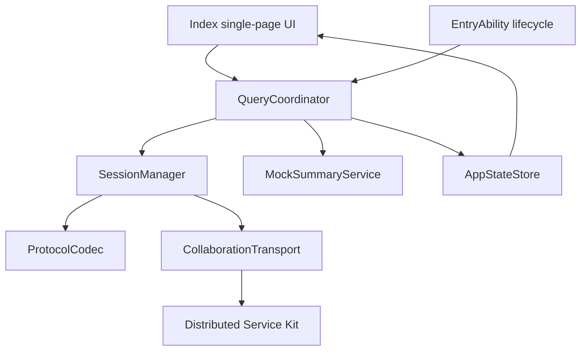
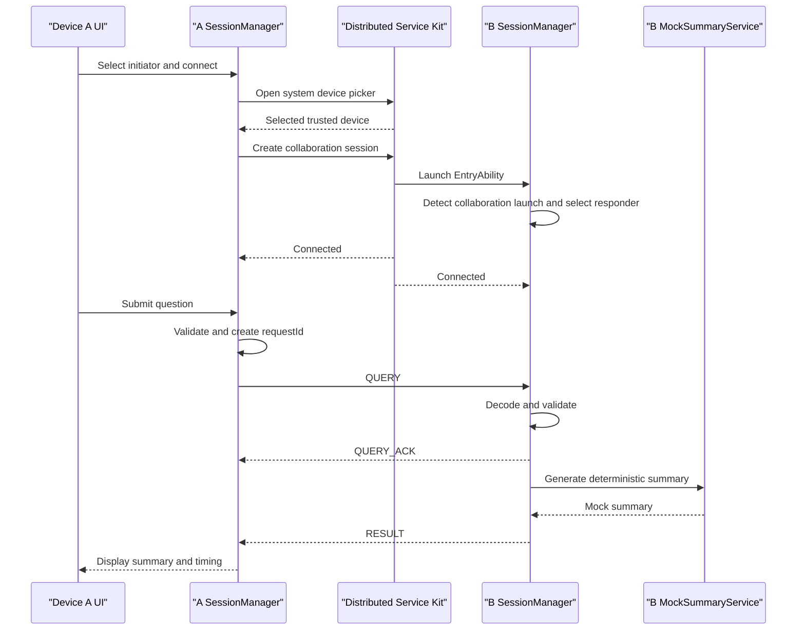

# SemaLink Cross-Device Communication MVP Design

> Date: 2026-07-14
> Status: Approved design
> Target: HarmonyOS NEXT ArkTS, API 24, existing `entry` module

## 1. Goal

The MVP proves one end-to-end path: a phone sends a knowledge query to a second trusted HarmonyOS device, the peer receives the query, generates a deterministic mock summary, and returns it to the phone. The peer may be closed before the request and must be launched through the cross-device collaboration flow.

The MVP uses two devices only. It does not integrate Xiaoyi, perform real document retrieval, transfer complete files, or introduce a local-area-network socket path. Mock data is explicitly allowed to validate the communication path.

## 2. Confirmed Product Decisions

- Both devices use the same Huawei account, the same bundle name, and trusted-device networking.
- Distributed Service Kit is the only MVP transport. Network Kit is a later extension.
- The system device picker selects the peer. The app does not implement device discovery UI.
- One HAP supports manually selected initiator and responder roles. A collaboration launch automatically selects the responder role.
- A connection can execute multiple queries sequentially, with at most one unfinished request.
- Failures never trigger automatic reconnect or resend. Recovery is a user action.
- The MVP uses one page for role, connection, query, result, status, and error presentation.
- Acceptance requires ten successful sequential queries in one session and one manual recovery after disconnection.

## 3. Architecture



The architecture has one business path and one transport implementation. A narrow transport boundary is retained so that a future `SocketTransport` can be added without changing query use cases or protocol objects. No empty socket implementation or runtime transport selector is part of the MVP.

### 3.1 Module Boundaries

| Module | Responsibility | Dependencies | Must not do |
|---|---|---|---|
| `Index.ets` | Role controls, connect action, question input, summary, status, and actionable errors | `QueryCoordinator`, `AppStateStore` | Call system communication APIs or mutate session state directly |
| `EntryAbility` | Detect normal versus collaboration launch and forward lifecycle events | `QueryCoordinator` | Parse protocol messages or generate summaries |
| `QueryCoordinator` | Expose connect, submit, and disconnect use cases; route requests and responses | `SessionManager`, `MockSummaryService`, `AppStateStore` | Call Distributed Service Kit directly |
| `SessionManager` | Own session state, listeners, timers, pending request, result cache, send/receive, and cleanup | `Transport`, `ProtocolCodec` | Render UI or implement mock retrieval |
| `CollaborationTransport` | Adapt Distributed Service Kit callbacks to application transport events | Distributed Service Kit | Interpret business payloads |
| `ProtocolCodec` | Encode, decode, size-check, and validate protocol envelopes | Protocol models | Make business or retry decisions |
| `MockSummaryService` | Produce a deterministic summary from a valid question | None | Read files, databases, or the network |
| `AppStateStore` | Hold observable role, connection, request, result, timing, and error state | Application models | Own system resources or timers |

Proposed source layout:

```text
entry/src/main/ets/
|-- entryability/EntryAbility.ets
|-- pages/Index.ets
|-- application/QueryCoordinator.ets
|-- communication/
|   |-- Transport.ets
|   |-- CollaborationTransport.ets
|   `-- SessionManager.ets
|-- protocol/
|   |-- ProtocolModels.ets
|   `-- ProtocolCodec.ets
|-- task/MockSummaryService.ets
|-- state/AppStateStore.ets
`-- common/
    |-- AppError.ets
    |-- IdGenerator.ets
    `-- Logger.ets
```

## 4. Data Model and Protocol

All cross-device content is UTF-8 JSON text. A message must not contain a file, URI, local file path, binary content, account credential, or complete document content.

```ts
type MessageType = 'QUERY' | 'QUERY_ACK' | 'RESULT' | 'ERROR';

interface ProtocolEnvelope<T> {
  version: '1.0';
  type: MessageType;
  messageId: string;
  sessionId: string;
  requestId: string;
  sentAt: number;
  payload: T;
}

interface QueryPayload {
  question: string;
}

interface QueryAckPayload {
  acceptedAt: number;
}

interface ResultPayload {
  summary: string;
  sourceDeviceAlias: string;
  processingMs: number;
}

interface ErrorPayload {
  code: string;
  message: string;
}
```

Protocol rules:

- `messageId` uniquely identifies one message.
- `requestId` correlates `QUERY`, `QUERY_ACK`, `RESULT`, and `ERROR`.
- The initiator creates `sessionId` when the collaboration session connects. The responder binds the first valid `QUERY.sessionId` to that transport session. All later messages on that connection must use the same value.
- `sentAt` and `acceptedAt` are Unix timestamps in milliseconds.
- A trimmed question must contain 1 to 1000 characters.
- A summary must contain no more than 2000 characters.
- An encoded message must not exceed 16 KiB.
- Unknown versions, unknown message types, invalid JSON, and missing or invalid fields are protocol errors.
- Logs contain message type, IDs, byte count, stage, and timing only. Full questions, summaries, device IDs, and account data are excluded.

The deterministic summary format is:

```text
Device B received the query about "{safely truncated question}".
This mock summary was generated on the remote device without real document retrieval or complete-file transfer.
```

The displayed product copy may be localized, but identical normalized input must produce identical summary content.

### 4.1 Application State

```ts
type DeviceRole = 'UNSELECTED' | 'INITIATOR' | 'RESPONDER';

type ConnectionState =
  | 'IDLE'
  | 'SELECTING_DEVICE'
  | 'CONNECTING'
  | 'CONNECTED'
  | 'WAITING_ACK'
  | 'WAITING_RESULT'
  | 'DISCONNECTING'
  | 'DISCONNECTED'
  | 'ERROR';
```

Only `SessionManager` initiates connection-state transitions. The UI invokes commands and renders store state.

## 5. Communication Flow



### 5.1 Connection

1. A normal launch starts in `UNSELECTED`. The user selects initiator.
2. Connect opens the system device picker.
3. Cancelling the picker returns to `IDLE` and is not reported as a communication error.
4. Selecting a device creates the collaboration session. Connection timeout is 10 seconds.
5. The system launches the peer. `EntryAbility` identifies the collaboration launch and automatically selects responder.
6. Both sides enter `CONNECTED`. The connection remains open for sequential queries.

The exact launch parameter and Distributed Service Kit call sequence must be confirmed against the API 24 SDK and two-device feasibility test before implementation is treated as complete. This design fixes ownership and behavior, not an unverified API signature.

### 5.2 Query

1. The initiator may submit only in `CONNECTED` with no unfinished request.
2. It validates the question, creates a `requestId`, sends `QUERY`, and enters `WAITING_ACK`.
3. The responder validates and immediately returns `QUERY_ACK`.
4. The responder generates the mock summary and returns `RESULT`.
5. The initiator matches `requestId`, records end-to-end timing, displays the summary, and returns to `CONNECTED`.
6. The user may submit another query or disconnect.

ACK timeout is 3 seconds. Result timeout is 10 seconds. A timeout clears the unfinished request and does not resend it. If the transport is still connected, the state returns to `CONNECTED`; otherwise it becomes `DISCONNECTED`. A late ACK or result for the timed-out request is ignored.

### 5.3 Serial Execution and Idempotency

- The responder accepts one unfinished request. A different `requestId` received while busy gets `E_BUSY`.
- A completed response is cached for the lifetime of the connection. Repeating its `requestId` returns the cached result without running the service again.
- Cache, pending request, listeners, and timers are cleared when the collaboration session ends.

## 6. Error Handling

```ts
interface AppError {
  code: string;
  message: string;
  stage: 'SELECTION' | 'CONNECTION' | 'PROTOCOL' | 'QUERY' | 'LIFECYCLE';
  recoverable: boolean;
}
```

| Condition | System behavior | User action |
|---|---|---|
| Device picker cancelled | Return to `IDLE`; no error dialog | Select again |
| No trusted peer available | End connection attempt and show account, Bluetooth, and trusted-network checks | Connect again |
| Permission or capability unavailable | Preserve system error code in metadata; do not retry | Correct device environment |
| Connection exceeds 10 seconds | Release incomplete session and enter `ERROR` | Reconnect manually |
| Empty or overlong question | Do not send; retain `CONNECTED` | Edit question |
| Message send fails | Clear request timers and pending state | Resubmit or disconnect |
| ACK exceeds 3 seconds | Fail request and return to `CONNECTED` if transport is alive | Resubmit manually |
| RESULT exceeds 10 seconds | Fail request and ignore late result | Resubmit manually |
| Peer disconnects | Clear pending work and enter `DISCONNECTED` | Select and connect again |
| Invalid protocol message | Drop it; return `ERROR` only if a valid request ID can be recovered safely | Inspect status |
| Responder is busy | Return `E_BUSY` without replacing active work | Resubmit later |
| Completed request repeats | Return cached result | None |
| Ability is destroyed | Unregister listeners, cancel timers, release session | Restart app |

There is no automatic reconnect or resend. All parser errors and system callback exceptions become `AppError` values and must not crash the app. User messages are short and actionable; detailed stage and system error codes go to privacy-safe logs.

## 7. Lifecycle and Cleanup

- The UI page does not own the collaboration session. Page recreation must not duplicate listeners.
- `SessionManager` owns registrations and provides idempotent cleanup.
- User disconnect moves through `DISCONNECTING`, releases the transport session, clears volatile request state, then reaches `DISCONNECTED`.
- Peer disconnect performs the same local cleanup without attempting reconnection.
- Ability destruction is the final cleanup boundary and releases all listeners, timers, caches, and transport resources.
- A second collaboration launch must not overwrite a live session silently. It is rejected or the old session is explicitly closed first. The MVP should reject it and surface `E_BUSY`.

## 8. Test Strategy

### 8.1 Unit Tests

- `ProtocolCodec`: valid messages, malformed JSON, missing fields, unknown version, unknown type, overlong question, and messages over 16 KiB.
- `MockSummaryService`: deterministic output, included question content, safe truncation, output limit, and no file/database/network dependency.
- `QueryCoordinator`: state restrictions, one-request rule, ACK/result matching, timeout cleanup, and late-result rejection.
- `SessionManager`: connection, send failure, disconnection, busy response, duplicate request, listener removal, timer disposal, and idempotent cleanup.
- Tests use `FakeTransport` and do not require Distributed Service Kit or physical devices.

### 8.2 Single-Device Component Tests

- Use a loopback fake transport for `QUERY -> QUERY_ACK -> RESULT`.
- Verify observable UI state transitions and the ability to submit the next query after completion.
- Verify invalid input, protocol errors, and timeouts do not crash the process.
- Recreate the page and destroy the Ability to verify that no duplicate listeners or timers remain.

### 8.3 Two-Device Acceptance Test

Prerequisites:

- Two API 24 HarmonyOS devices install the HAP with the same signature and bundle name.
- Both devices use the same Huawei account and trusted-device networking.
- SemaLink is closed on device B before the main test.

Main path:

1. Launch SemaLink on device A and select initiator.
2. Connect and select device B in the system picker.
3. Verify B is launched and automatically enters responder mode.
4. Submit ten distinct questions sequentially in the same connection.
5. For every query, verify ACK receipt, matching `requestId`, summary content tied to that question, and return to the ready state.
6. Disconnect and verify both sides release session resources.

Disconnection recovery:

1. Connect and start a query, then close B or interrupt the trusted connection while it is processing.
2. Verify A reports disconnection, clears unfinished work, and performs no automatic retry.
3. Manually select and reconnect to B.
4. Submit one query and receive a valid summary.

### 8.4 Acceptance Criteria

- B is launched from a non-running state and selects responder automatically.
- Ten sequential queries in one session all succeed without cross-matched results.
- One forced disconnection is detected and manual reconnect restores the query path.
- There are no crashes, duplicate listeners, or pending requests after cleanup.
- No message contains a file, URI, complete document, or binary payload.
- Connection time, ACK latency, result latency, and encoded byte counts are recorded. The MVP has no hard performance threshold.

## 9. Scope Exclusions

The MVP excludes Network Kit, sockets, LAN discovery, IP pairing, Xiaoyi, real retrieval, ArkData, model inference, file transfer, multi-device routing, concurrent requests, cross-account operation, automatic retry, background long-running tasks, and a production security architecture.

## 10. Evolution Path

### 10.1 LAN Mode

Add `SocketTransport` plus local discovery or pairing. Keep `QueryCoordinator`, protocol envelopes, and query UI independent of the selected transport. Define socket framing, authentication, and address exchange only when that work starts.

### 10.2 Bidirectional Initiation

Replace the fixed app-level role with a session-level role so either device can initiate a new session while both can respond. Then evaluate a peer directory, heartbeat, concurrency, and recovery. Existing `requestId`, `sessionId`, and protocol version fields remain the compatibility foundation.

## 11. Implementation Gate

This document defines design only. No implementation begins until the user reviews this written specification and explicitly approves moving to an implementation plan. The next process step after that approval is to create a detailed plan with the `writing-plans` skill.
